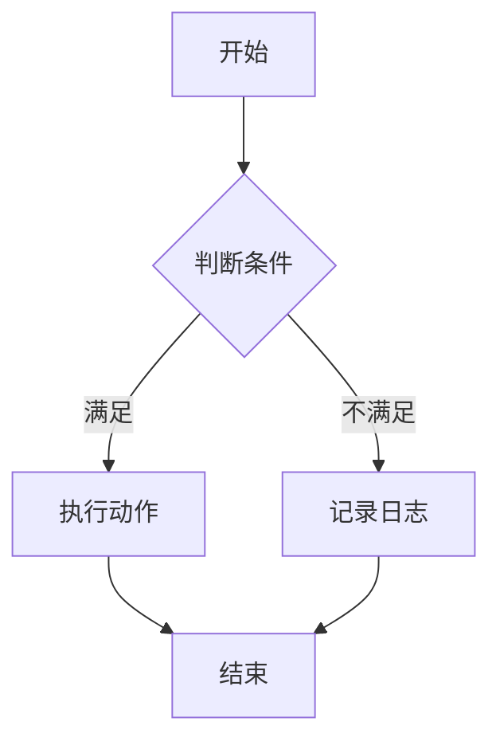
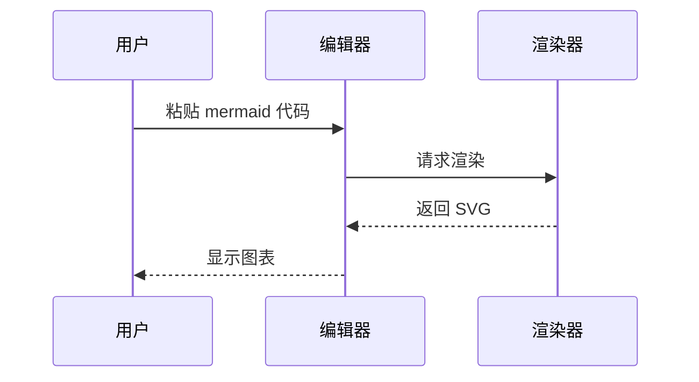
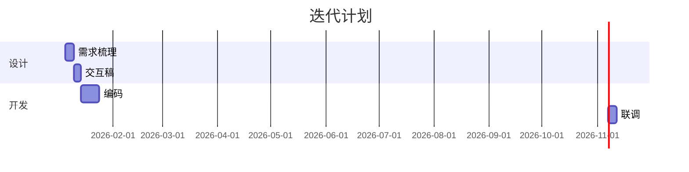
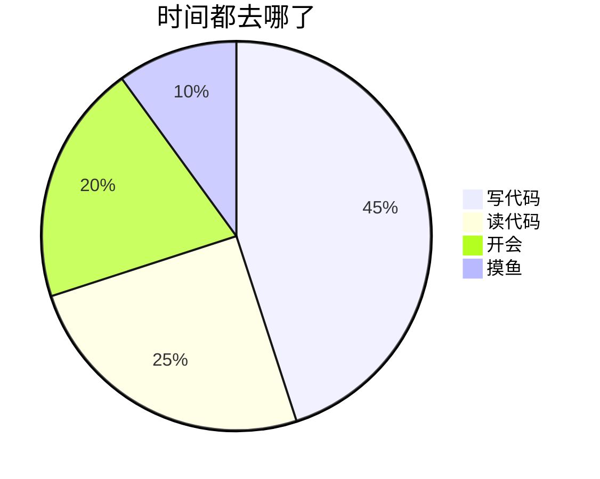

# 图表验收：请你亲手试这几件事

这份文档是给你手动验收用的。下面四种图型 + 一处坏语法，覆盖了 MVP 的全部路径。

## 一、流程图：试着在源码里改一个节点名

把下面的 `执行动作` 改成 `执行动作（改过了）`，**图应当立刻跟着变**。



## 二、时序图：中文参与者名



## 三、甘特图



## 四、饼图（中英文混排）



## 五、坏语法：应当**可读地报错**，不是白屏

```mermaid
flowchart TD
  A[忘了闭合 --> B
```

## 请你重点试这几条

1. **↑ / ↓ 穿过图表块**：光标放在图上面一行按 ↓、下面一行按 ↑，
   看是不是"进块落在图里的内容行、再按一下越过围栏出块"，而且**列位置不丢**。
2. **在块内改内容**：把 `A[开始]` 改成别的，看**图会不会跟着更新**（这是修过的一个坑）。
3. **导出 PDF**（更多 → 导出 → PDF）：看图表有没有**渲染成图**、白纸黑字是否正常。
4. **导出 HTML** / **复制为知乎格式**：看贴到白底文章里图是否正常。
5. **主题**：在深色主题下导出，看**图是不是仍然用浅色**（纸面是白的，图不该是黑块）。

## 最后一段正文

这一段用来确认图表**没有吃掉后面的内容**。
