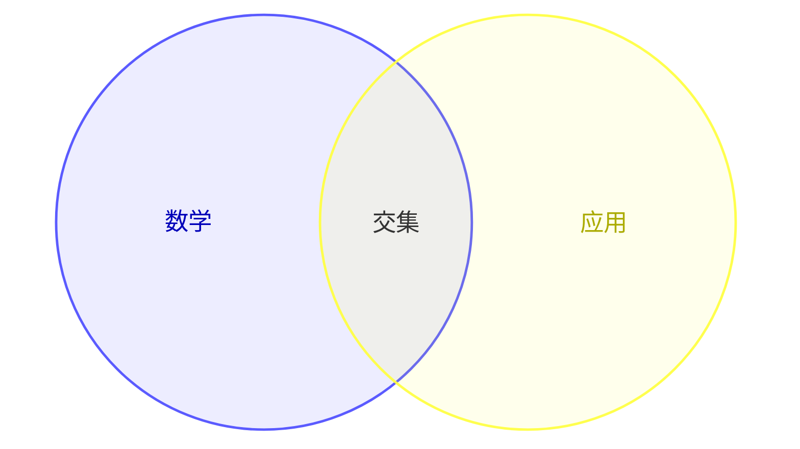

# Typora Editor 1.0.9 / VSIX 0.1.21-local

## Mermaid

插件和 App 共用官方 Mermaid **11.17.2** 的完整单文件 dist，附 MIT 许可证及 npm 下载完整性记录。Vditor 原本调用 `initialize` / `render`，实测无需 `mermaidAPI` shim，也没有触发回退。

Venn、TreeView、旧流程图、时序图已通过 IR / WYSIWYG、亮暗主题和错误后恢复测试。新版语法例如：

````markdown



````

官方资料：[11.17.2 发布记录](https://github.com/mermaid-js/mermaid/releases/tag/mermaid%4011.17.2)、[Venn 语法](https://mermaid.js.org/syntax/venn.html)、[TreeView 语法](https://mermaid.js.org/syntax/treeView.html)。旧 dist 备份位于插件项目的 `tools/backups/mermaid-11.6-before-11.17.2`。

## 自动保存与版本历史（仅桌面）

- 文件 → **自动保存**：默认开启，最后一次输入后 1.5 秒保存；关闭确认仍保留。旧配置自动补齐默认值，明确关闭过的选项保持关闭。
- 文件 → **本地快照**：默认开启。打开基线、成功保存、持续未保存期间每 5 分钟记录版本；连续相同内容复用快照，空闲时没有周期轮询。
- 文件 → **版本历史…**：显示时间、字数、大小及内容预览；支持键盘选择、Esc 退出、打开快照目录、恢复为副本及打开副本。
- 快照位于 `%APPDATA%\TyporaEditor\snapshots\<规范化路径 SHA-256 前 12 位>\YYYYMMDD-HHmmss.md`。同秒冲突加递增后缀，绝不覆盖旧快照。每文件最多保留 50 份，按 LRU 淘汰；列表按版本时间倒序，查看/恢复旧版本会更新使用顺序。
- 恢复副本为原目录下的 `<文件名>-YYYYMMDD-HHmm.md`，重名继续添加数字后缀。预览最多显示前 12 万字符，恢复始终写入完整内容；原件及窗口中的未保存编辑均不改变。

保存现在串行进行，并在同目录临时文件完整写入后替换原文件。写盘期间的新输入保持未保存状态；失败时不把文档标为已保存，也不会关闭窗口。发现外部修改会保留双方内容并暂停自动覆盖；文件被删除或移走后不会由自动保存悄悄重建，显式 Ctrl+S 仍可重新保存。

## 性能及验证

实测后采用单次扫描的字数统计，并缓存未变化内容的统计，避免保存状态刷新时重复计算。结果和适用范围见 [PERF-RESULTS-1.0.9.md](PERF-RESULTS-1.0.9.md)。

数据保护测试涵盖写盘竞态、写入失败、恢复失败、外部修改、删除、文件切换、关闭确认、5 分钟快照与 1.5 秒保存重叠、同秒 50+ 次快照、LRU、配置迁移、损坏索引、空内容、大内容及恶意快照 ID。统计等价性测试覆盖全部 UTF-16 编码值与随机混合文本。

桌面安装包与便携版位于 `dist/`，插件包位于 `../Typora-Editor/dist/`。发布文件散列及最终验证记录见 `release-1.0.9.json`。
