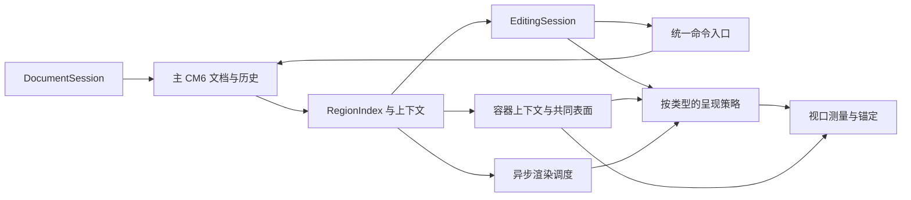

# CM6 特殊区域统一架构方案（3.2.13 基线）

结论：保留 CM6，把图片、公式、代码、Mermaid 的**源码归属、容器上下文与共同表面、编辑会话、命令、选区映射、渲染生命周期和视口测量**统一。各类型保留合适的呈现方式。第一批以图片“源码在上、预览保留”为交付目标，同时让公共机制能够被后续类型复用。

这是研究方案与基线记录，统一架构尚未整体实施。3.2.14 已单独完成公式浮层横向几何修复，范围见 [浮层记录](LOG-3.2.14-FLOAT-LAYOUT.md)；下述引用容器断裂案例仍待独立复现与修复。现有图片展开规则仍有待实现。性能优劣需要同机同负载测量，本文不以架构名称宣称行业最优。

## 已核实的基线

取样对象是实际安装的 3.2.13，EXE SHA256 `b73fd93ee4dd2ebdc4f39e686df57cfbddc00952cc7412777ed7b22008232ddd`，ASAR SHA256 `08a6de1a9b6be8a6b8033ec5c8dbf5b6fd3f8277a674ed4c35bcc6b58dad4e51`。测试使用独立 profile 和文档副本，退出时自有进程残留为零。

| 对象 | 实际观察 | 结论边界 |
|---|---|---|
| 独立、引用内、行内图片的合成夹具 | 中心单击落在源码边界时保留图片；双击进入源码内部后，图片被移除 | 三种形态均未实现源码与预览共存；不能将一次中心单击推广为所有点击位置的行为 |
| 已滚动的引用图片 | 展开后下方文字屏幕坐标上移 156.5px，scrollTop 仅减少 8px | 只验证 scrollTop 无法证明视觉稳定 |
| 大型图文文档私有副本 | 9,031,957 bytes、202 行、当前扫描识别 26 张图；最后一张在第 198 行，图片源码 30 个 UTF-16 单元；进入源码后预览消失 | 原件字节保持不变，截图由主控检查；该文档的私人截图没有发布 |
| 同一最后图片的输入链 | 单击后立即输入、Undo、Redo 后立即继续输入，完整源码符合预期且焦点保持 | fresh profile 下此链未复现失焦；不代表原使用条件下的失焦已解决。输入导致图片位置映射，不能拿旧字面位置判断图片消失 |
| 中型数学教材私有副本 | 261,927 bytes、178,101 UTF-16 单元、2,609 行；全文装入和导航保持焦点 | 原件及副本 SHA256 一致，原件修改时间未变；全文装入不等于全文视觉验收 |
| 教材当前源码扫描 | 2,847 段：display 42、inline 2,805；起始引用深度 0/1/2 分别 366/2,359/122；分式 113、矩阵 3、根号 2 | 是当前扫描器的输出，不是 KaTeX 成功渲染数量、标准兼容率或测试通过数 |
| 教材 8 个精确上下文样本 | 多层引用、多行公式、矩阵、分式、中文紧邻、列表、根号、相邻公式的实际操作链 8/8 通过 | 覆盖实际样本的输入、历史、反向选区、剪贴板与保存；未据此证明系统 IME、拖拽、所有公式或所有操作组合 |

数学实际链为：源映射字形点击 → **不插等待或焦点修复，立即输入 R** → Undo → **Redo 后立即输入 1** → Shift 反向选中 R1 → 原生 Ctrl+C / Ctrl+X / Ctrl+V → Undo paste / Undo cut → 核对完整 UTF-8 LF 保存字节。夹具来自原文的完整连续上下文，保留引用与列表前缀。8 个操作目标中两者共享同一段上下文，目标公式不同；相同初态可产生字节相同的截图，不能据此认定图片被复制或重复取证。当前链确认进入指定公式的源码范围，并以实际原生选区核对输入结果；它没有独立证明每个字形的精确落点，也不代表矩阵所有内部位置已编辑。后续 source-codec 门须增加从原始字面片段计算的精确位置预期，不能用落点反推正确落点。

首组运行在四个用例通过后，被第五个样本 ID 的大小写格式检查中断。原运行 manifest 已按哈希精确恢复留存；四个已通过用例与校正后规范 manifest 的内容哈希和范围相同。只补测余下四个，未把工具设置失败计为产品失败或整体通过。两组运行的完整产物、探针身份相同；剪贴板均恢复，无 pageerror，无自有进程残留。

合成图片像素已由 DeepSeek Flash 逐张检查，并与独立纯文本对抗审查收敛。教材 8 个目标的基线全幅与动作局部合计 16 张图由 Flash 逐张检查。列表样本可见公式浮动预览覆盖下一项部分正文，分式样本可见补全面板遮住部分预览；这是后续浮层布局与命中的明确验收目标。块公式的局部裁剪未见预览不能证明预览消失，需要全幅与实际 DOM 几何补判。数值、源码契约与视觉观察分别承担各自结论。

## 当前问题的架构来源

当前实现已经有可复用基础，但交互决策仍分散：

| 位置 | 当前职责 | 需要集中之处 |
|---|---|---|
| `dsh-markpilot/src-cm6/main.js:3113` | 图片与行内标记的 decoration；短图片源码内部选区会使预览替换失效，长 src 与坏图另走分支 | 图片激活意图与源码、预览显隐解耦；坏图也应可编辑源码 |
| `main.js:1085`、`main.js:1116` | 行内与块公式，按 range.head 展开，浮层预览 | 保留现有选区语义，接入公共会话与测量接口 |
| `main.js:341`、`main.js:362` | Mermaid 范围与选区驱动的源码/图表切换 | 使用公共 region 身份、异步发布与高度通知 |
| `main.js:1857`、`main.js:1870`、`main.js:1923` | 格覆盖层选区同步、最小 diff、CM 历史回填 | 提取真实编辑 owner 的提交/选区/历史/退休接口 |
| `markdown-context.js`、`math-source-map.js`、`cell-source-map.js` | 围栏上下文、去引用前缀的数学映射、格转义映射 | 接口统一，保留各 codec 的真实语义 |
| `main.js:3787`、`main.js:4934`、`splitview.js:77` | 指针手势、菜单历史、源码面板落位 | 统一命令上下文和交接，保留手势与控件的意图 |

根本问题是把“源码正在编辑”和“预览必须被移除”当成同一个状态，再由多个事件入口分别补救。为每类区域添加输入框会继续分裂历史、剪贴板和 IME。公共机制应消除重复状态与重复决策。

## 引用容器与块级子区域：补充反例 Q01

连续引用中的 `$\begin{aligned}…\end{aligned}$` 可以包含多行推导，即使 Markdown 源码只有一行。补充截图显示该公式位于两段带底纹、左边线的引用文字之间，公式所在带状区域没有引用底纹，左边线也在此断开。原始片段留在私有测试目录；截图所属安装版本尚未独立核实，没有进行 Typora 的同片段实机对照。本项是已记录的可见反例及静态风险，尚未记为已修复或验收通过。

当前源码的对应路径是 `main.js` 的 `scanMathSpans`：同一行闭合的 `$\begin{…}…$` 被标记为 `display:true`；`buildBlockMath` 以 `block:true` 替换为数学 widget。引用底纹和边线则主要属于 `.cm-line.mp-quote`，数学块根节点为透明背景，调用也没有传入父引用上下文。这与截图现象相符，仍需在实际安装副本上核对 DOM、源码范围与像素，才能确认完整因果。表格已有独立 `qDepth/qLead` 外观处理，说明同一职责已在不同类型中分散实现。

同族静态候选还有引用深度：`scanLineStyles` 在引用行内统计整行 `>` 数量，正文或公式中的比较符号可能被计入深度。补充 `> $x>0$` 等负控，深度由实际引用前缀与语法父路径确定；该候选尚未实测。

**共同契约：子区域改变呈现形态时，保持其语义父容器。** 公式从行内投影变成多行块、进入源码编辑或恢复预览，都保留正确的引用深度、底纹、左边线和内容缩进。父容器表面覆盖实际占用的公式高度及其内部间距；同一引用内的显式 `>` 空行保持连续，真正结束引用后的普通正文保持独立。公式自身的底色、高亮与错误状态仍可表达，但不替代父引用表面。

引用的多段落与嵌套语义参考 [Typora Markdown Reference](https://support.typora.io/Markdown-Reference/#blockquotes)。文档说明不能替代这一 `$…aligned…$` 形态的版本对照；实施时记录 Typora 版本、主题、字体、缩放与完整连续上下文，再以相同片段核验容器连续性。片段首句没有 `>`，是否属于此前引用须依据完整上下文解析，不能仅因视觉相邻就扩大引用范围。

公开的等价形态使用合成文本，原片段和截图不随方案发布：

```markdown
Before $a$.
> $\begin{aligned}x&=a+b\\&=c+d\\&=e+f\end{aligned}$
> Where $a=b$.
>
> Continuation.
```

容器上下文来自结构层，包含稳定身份、父路径、深度、源码范围与上下文版本；数学 `display` 只决定呈现方式。引用前缀修改、移出引用、嵌入列表及撤销恢复时，子区域重新绑定上下文，纯内容缓存可以复用，挂载样式、映射与尺寸不得沿用旧容器。引用底纹、边线和版心由共同呈现机制生成文本片段与块预览片段；使用 CM6 支持的装饰与 widget 包装，不重写 CM 自有 DOM 树。改变高度的投影仍采用直接装饰来源，测量接入公共 read/write 周期。

相邻的引用内矩阵、分式、图片、表格、围栏代码和 Mermaid 列入同族测试，当前未据此宣布它们均有缺陷。代码中的公式定界符保持字面语义。

## 目标结构



推荐模块边界如下。它们是职责划分，实施时按可验证切片提取，避免一次搬迁所有代码。

| 模块 | 契约 |
|---|---|
| `region-index` | 提供区域范围、类型、内部可编辑片段、父容器路径/深度/源码范围及上下文版本；父容器与数学 display 等呈现属性独立。第一阶段适配已有字段，不再增加全文正则扫描。之后逐步合并结构计算。位置随 ChangeSet 映射，受影响结构重新识别 |
| `container-presentation` | 从共同容器上下文生成背景、边线、缩进和内容版心，覆盖文本与块级子区域的实际投影；保留嵌套与真实容器边界，选区层可见。没有第二份文档或编辑 owner |
| `source-codec` 接口 | 文档 UTF-16 坐标与渲染、格 DOM、规范化数学坐标互换；保留引用前缀、换行、转义、两端方向。不同类型实现各自 codec，不强迫线性偏移公式 |
| `region-session` | 保存文档/view/region 身份、真实选区、输入 owner、手势与呈现意图；明确 entering/editing/composing/suspended/disposed 的交接。会话不持有第二份权威 Markdown 或撤销栈 |
| `editor-commands` | 键盘、菜单、工具栏、搜索返回、源码面板通过同一上下文执行。区分已处理、不可用、未处理；不得空历史命令落到别的控件 |
| `region-presentation` | 生成源码与只读预览的 decoration，源码显隐、预览显隐、选中高亮、焦点分别决策。布局与输入内容分开 |
| `region-renderer` | 内容缓存、inflight 合并、过期丢弃、取消、挂载/销毁、资源边界与高度通知。纯渲染缓存和具体 widget 的 owner/位置身份分开 |
| `viewport-anchor` | 统一坐标换算、CM 测量周期与有条件的锚定；不以固定延时反复抢焦或拉回滚动 |

数学预览、补全、格工具栏等浮层共用该视图的测量调度与碰撞规则：优先保证活动源码与光标可见，核对被覆盖正文的命中和读取方式，不把“当前实现是浮层”当作遮挡下一行的验收通过。不要各自添加滚动监听和重复布局读取。

文档和历史权威仍是主 CM6；保存与资源路径的权威仍是 DocumentSession/DocumentStore。只读源码分屏拥有最小 state，引用同一个 Text；不把主视图插件整套装进从视图。DOM 生命周期由对应 ViewPlugin 所有，销毁即解除监听和挂载。既有格覆盖层继续在 body 外层，不能直接搬进 `.cm-content`。

## 各类型交互契约

| 类型 | 展开/编辑方式 | 必须保留的性质 |
|---|---|---|
| 独立、引用内图片 | **单击进入图片会话：上方显示主 CM6 可编辑源码，下方保留只读图片**。再次点击图片不关闭编辑；Esc 或明确离开可编辑范围退出，工具栏操作与普通滚动不冒充退出意图 | 图片不出现移除/空白帧；首次落点可预测；改 URL、alt、尺寸仍是普通文档编辑；坏图保留可解释占位和可编辑源码 |
| 行内图片 | 首选原生 CM 源码 + 区域末尾只读 block 预览，原 Markdown 不加换行；允许临时视觉拆段，原型门检查前后正文、上下键与选区 | 源码位于预览上方；不默许用“源码与图片同处一行”替代要求。原句几何完全不变尚需验证，不承诺同时固定所有元素 |
| 长 data URI 图片 | 保留图片；研究主 CM 内对 payload 的明确折叠，显示结构与属性，显式展开完整字面量 | 折叠是呈现，不能把省略字符串写回文档；复制和保存必须完整；不把数十万字符每次灌回可换行 DOM。边界含 512 字符前后及实际大型图文副本 |
| 行内/块公式 | 沿用原生源码 + 只读数学预览；使用当前映射。**仅选区 head 所在公式展开，其他选中的公式继续渲染并高亮** | 不因选区相交而展开全部公式；源复制保留定界符；多行环境或块级替换保留父容器；预览浮层不意味着源码展开没有重排 |
| 普通代码、代码围栏 | 原生文本编辑、语法高亮、统一导航/历史/命令 | 围栏是普通可编辑字符；代码内图片、数学符号等保持字面语义，不能激活嵌套渲染 |
| Mermaid | 围栏源码编辑 + 有身份的只读预览；正常输入合并渲染任务 | 更新只发布当前有效结果；语法暂时错误时保留可编辑源码，若显示上次有效图则明确其状态；预览不抢焦、不自行导航窗口 |
| 引用、列表及嵌套 | 容器提供上下文、共同表面、缩进、源片段映射，子区域复用同一会话协议 | 底纹与边线覆盖块预览；深度、前缀、缩进与字节保真；移出容器或变成代码后正确退休子区域 |
| 格内特殊区域 | 活动格为编辑 owner，子预览委托给格 codec 与公共协议 | 不嵌套第二个输入 owner；保留格内普通复制、表选择、转义竖线、数学源码与 CM 历史的区别 |

原生 CM 支持 block widget 在文档行内形成多个视觉 textblock。影响垂直布局的装饰必须是**直接来源**；StateField 是组织选择，`EditorView.decorations.compute([...], state => DecorationSet)` 也属于直接来源，不能将它笼统视为禁用形态。[官方装饰说明](https://github.com/codemirror/website/blob/main/site/examples/decoration/index.md)

行内图片原型先比较两种原生 CM 呈现的几何和导航结果。第一阶段不引入 raw-input proxy。独立输入框可能绕过原生 copy/cut 对 linewise-copy 的复位，也绕过 CM 的富数学粘贴处理；这些是静态风险，尚未宣称实际失败。不能通过读写 CM 私有标志修补。

## 焦点、选区和历史

1. 图片点击进入由显式意图驱动；公式展开保留 head 规则。命令可命中区域边界，不代表粘贴终点必须展开。禁止强迫命令归属和呈现使用相同闭区间判据。
2. mousedown 记录手势并保留默认选区；拖动期间不因普通单击逻辑抢选区。mouseup 确认为单击后激活。使用当前手势的方向、移动、scroll 与文档身份，不永久冻结全部区域。
3. 同一个原生编辑面内的呈现变化不重新 focus；确有输入 owner 交接时，按意图**同步交接一次**。保持编辑 DOM，尤其在组字时不重建。搜索、图片地址框等控件保留自己的原生历史。
4. 只有文档编辑进入 CM 历史；展开、定位、渲染完成不进历史。粘贴等离散操作使用既有 history 分组机制；输入与预编辑不混为一次事务。[官方历史实现](https://github.com/codemirror/commands/blob/main/src/history.ts)
5. 历史命令前同步真实 owner 的选区；历史之后重新读取当前源码和 region，恢复方向性选区并允许立即输入。普通 copy/cut 继续原生 CM 分支，特殊源码/格/图片语义才由相应适配器处理，不将所有复制都改成一个强制拦截器。
6. IME 保留合法预编辑缓冲和 composition 生命周期；外部切换、提交、历史和保存有明确边界。合成事件及普通 Unicode 输入不替代 Windows 真实候选提交验收。

已知重新加载 P2 是公共会话的重要门槛：活动格真实 DOM 反向选区可能暂时领先 CM。只恢复焦点，可能把 `|b` 错映射成 `b`。必须先 flush 真实 owner，再进行源码映射和请求交接。成功 reload 会创建新文档身份，不能用“新旧 documentId 必须相等”挡住合法响应；需要请求来源、路径、旧身份和当前意图一起核对。本文未修复该 P2。

## 视口稳定的可测契约

源码放在图片上方会增加高度。必须确定优先锚点：**点图片展开时稳住被点图片的屏幕位置；连续源码输入时稳住活动光标。** 无法同时固定上方所有文字、图片和下方所有内容。

- 可滚动空间足够时，若上方源码新增 H 高度，滚动增加相应 H 才能保持图片位置；此时图片以下的屏幕位置通常也保持。若固定旧区域顶/源码顶，则图片及下方会下移 H。这两种策略不能混写成一组判据。
- 顶部/底部钳制、图片大于视口、源码光标超出视口时，允许**最小必要移动**，记录不可达原因和实际几何。不得把恒定 scrollTop 当作视觉通过。
- 使用版本对应的公共 `scrollSnapshot`/`requestMeasure`，统一 read/write 阶段、缩放与布局坐标；delta 先换算到 scrollTop 的坐标系。保持同一文档或显式映射 effect 的限制。[官方视图 API 实现](https://github.com/codemirror/view/blob/main/src/editorview.ts)
- 图片 load、Mermaid 完成等异步变化通知 CM 重新测量，保留估计/已知尺寸。异步回调不取得焦点、不自动恢复旧用户滚动；新 wheel、导航、编辑、换文档使旧锚定意图失效。
- 产品不设置 0/45/150ms 循环焦点或滚动修复。测试可在多个时点拍帧以发现迟发抖动，但不能帮助产品纠正焦点、选区或滚动。
- 可达场景暂以锚点误差不超过 2 CSS px、无图片空白帧、稳定后无迟发拉回作为原型门槛。边界钳制按最小必要移动验收；具体容差经同机 DPI/zoom 尺子体检后冻结。

## 性能路径

优先去掉重复扫描、重复布局和重复渲染，再考虑新 Worker 或新库：

1. **纯选区移动不重扫文档。** 区域命中用有序范围索引，更新旧/新活动 region 与相关高亮；不每移动一次就遍历所有 2,847 段构造全部投影。
2. 文本变化通过 ChangeSet 映射未受影响范围，局部重新识别被编辑的区域和结构依赖。围栏、引用、定界符、语言标记等变化按语法边界扩大失效；无法确认同步边界时允许完整重建，不能以固定几行窗口换取错误语义。
3. 区域语义不依赖 viewport。可见区控制 DOM、解码与渲染优先级；块级高度装饰仍由直接来源提供，使用尺寸估计维持高度图。
4. 缓存纯结果与挂载身份分开。图片必须包含解析后的文档基址；相同相对 src 位于不同目录不等价。KaTeX/图表 DOM 的 source map、主题、宽度、容器及 owner 必须正确复绑定；相同长度的源码不代表相同内容。
5. 渲染有结果缓存与 inflight 表，合并重复工作；文档/view/region/mount 或内容版本已改变的结果不能发布。不可取消的计算也必须能丢弃结果。
6. 新文档/销毁清理会话、测量请求、挂载、Worker 与资源引用。连续进入退出、改内容、撤销及开关分屏不能持续增加监听器或内存。
7. Worker 的旧树只作镜像，保留 revision、实例和 Text 身份校验。结构未准备好时不借旧树做当前编辑决策；使用已验证的局部上下文或明确原生解析回退。

性能测量覆盖中型教材公式内部、大型图文最后图片、活动格和深引用编辑，分别记录首笔及稳态 p50/p95/p99、同步扫描范围、布局次数、重复 render、Worker ready 与内存。输入到下一帧暂以同机普通热编辑 p95≤50ms 为目标；大型 URI 展开、冷启动和合法结构重建单列，不混用预算。此前性能套件在空白处通过，不能替代这些热路径数据。源码读回、哈希和截图探针不得混入性能计时。

## 测试策略：功能形态 × 容器 × 操作链

DEBUG-DB 保存已知反例和证据索引；覆盖来源是**状态转换与交互契约矩阵**。每个真实缺陷先固化最小反例，再补同族边界；不能靠不断堆独立探针数量计算覆盖率。

| 维度 | 必测形态 |
|---|---|
| 区域 | 短/长 URI、坏图、行内/块数学、不同定界与环境、代码、Mermaid 正常/错误/更新、格中区域 |
| 容器 | 正文、中文紧邻、多层引用、列表与缩进、引用内代码/图表/公式、格内嵌套、未闭合/改变容器；单 `$` aligned 的块级投影、引用空行和前后引用文字的共同表面 |
| 选区 | 折叠、正向/反向、两端边界、跨多个类型、跨视觉折行/屏幕、多选区、含 emoji 的 UTF-16 映射 |
| 进入退出 | 单/双/三击、上下左右键、Home/End/PageUp/PageDown、Ctrl+Home/End、Esc、点预览/源码/正文、工具栏、搜索与只读源码面板返回 |
| 编辑与历史 | 连续输入、Enter/Backspace/Delete、选区替换、改/删定界与引用前缀、撤销重做后立即继续输入、跨区域历史、整段删除后恢复 |
| 剪贴板 | 原生 plain/HTML、公式子段/整段/混合正文、图片 bitmap、格 TSV、空选整行 copy 后子选 copy、拖选后 copy/cut/paste、待图期间撤销/切文档 |
| 手势 | 键盘、鼠标、组合键、键鼠配合、真实按下→多次移动→抬起的拖拽；前后方向、跨屏、滚动中拖选与反转 |
| 生命周期 | 图片延迟/失败、过期渲染回包、搜索/对话框、换文档、同路径 reload、保存/另存/重开、窗口/分屏/主题/缩放切换 |

每族保留五通道的实际操作链；跨区域选择、组字、clipboard 与异步交接是必测高风险组合，不由两两组合采样替代。其余合法组合采用约束采样、固定种子和状态机测试。先在模型层验证源码/选区不变量，再在真实安装产物上验证代表链与所有已知反例；失败种子缩小后进入回归。

统一判据：真实输入确实到达 owner；完整源码和磁盘字节正确；方向性选区与复制载荷正确；源码与预览符合各类型策略；焦点和光标可见；视口按可达锚点稳定；无崩溃/持续泄漏。CM 暂时落后于格 DOM 的合法选区延迟，在真实命令边界判定，不用测试强制同步。

Q01 的计划验收链与相邻边界如下，均为待执行项：

| 链/边界 | 判据 |
|---|---|
| 单 `$` aligned、跨 Markdown 行的 aligned、`$$` 块、矩阵/分式；一层/两层引用及列表中引用；正文/公式内 `>` 比较符 | 源码结构与父路径正确，比较符不增加引用深度；公式全部行、引用内空行及相邻文字的底纹/边线连续；普通正文对照保留真实容器边界 |
| 预览点击 → 立即输入 → Undo/Redo → 立即继续输入 → 离开后恢复渲染 | 源码、焦点、方向性选区与锚点正确；各关键帧保留容器外观；head-only 规则不退化 |
| 方向键进出、Shift 点击、正反向拖选跨文字/公式/引用空行；Ctrl+C/X/V 后撤销 | 五通道使用真实输入；高亮位于底纹之上；复制/保存保留原定界符、引用前缀与换行 |
| 同一公式从 `>` 改为 `>>`、移入/移出引用，再连续撤销/重做 | 内容相同也重新绑定父容器与深度；复用 widget 不保留旧背景、缩进、映射或高度；恢复后字节与外观一致 |
| 主题、缩放、窄宽视口、分屏和滚动离开/返回；语法暂时未闭合 | 背景覆盖测得的投影高度，边线和内容版心随共同测量更新；公式本地滚动，边界内可读；临时源码和错误占位也保持已确定的容器归属 |
| 引用内图片、表格、代码和 Mermaid；异步更新后继续编辑 | 同一容器契约覆盖各类型；代码字面负控、过期回包退休与输入 owner 保持；这些类型的缺陷状态分别取证 |

先保留该反例的完整连续上下文和负控，再检查结构父路径、实际投影几何、像素中的底纹/边线与选中高亮。仅存在 `.mp-quote` 类不算视觉通过。突变门分别移除块投影的容器绑定、忽略 widget 复用时的上下文版本，要求原失败臂变红、普通公式对照成立、精确恢复后同臂通过。

教材不含围栏内 dollar 与 inline-code dollar 的实样负控，这些形态另用公开合成夹具补齐。原文特征不存在时记录缺口，不伪造原文覆盖。当前 8 条链尚未测试拖拽、真实 IME、跨屏选择、HTML-only 粘贴、重开和性能。

每个独立根因在一次性副本中移除对应机制，要求同一原始失败臂变红、相邻正对照仍成立，再字节精确恢复。共享机制冻结后完整回归一次；原型和修改期间只跑失败臂及受影响边界，实装再核安装边界与主目标，避免重复全套。

## 迁移顺序与交付门

| 批次 | 实施范围 | 才能进入下一批的条件 |
|---|---|---|
| 1：公共契约与图片 | 提取只读 Region/Context 接口、父容器共同表面、会话/命令归属和测量；以 Q01 作为块投影容器门，再做独立、引用及最后图片；行内布局与长 URI 用有界原型决策 | Q01 引用底纹/边线连续、源码保真；单击源码在上、图片连续保留、焦点与锚点正确；编辑/历史/clipboard/五通道/坏图/基址/长 URI 达标；无新输入历史；当前教材 8 链不回退；因果突变有效 |
| 2：公式与格会话 | 接入数学/格 source codec、选区与历史交接、共同焦点生命周期；保留现有导航算法，逐入口迁移 | head-only 规则、上下目标列、原生源码复制、反向选区、真实 IME及重复撤销均通过；reload P2 的焦点与真实选区一起达标 |
| 3：代码、Mermaid 与嵌套 | 接入围栏/容器 ownership，图表异步调度与错误/旧预览策略；完善原语法边界 | 代码字面负控、引用/列表嵌套、改/删围栏、迟到回包、跨区域选区与资源释放通过 |
| 4：共同性能与实装 | 在稳定契约上合并扫描、局部失效、可见区渲染与缓存；冻结完整回归、独立视觉/手势复核、打包实装 | 热路径数据达预算，内存不持续增长；真实产物载荷相符、安装边界通过，未测限制清楚 |

第一批不同时重写导航、解析、保存与所有 UI。每批必须交付可独立验证的用户功能及已经使用的公共机制；不能只建空框架，也不能只为最后一张图增加特殊分支。原型仍不稳定时，报告具体阻断并收敛实现范围，不靠计时器或放宽判据赶交付。

## 工具与证据位置

- 通用私有语料输入工具：[corpus-math-workflows.cjs](../tools/quality/corpus-math-workflows.cjs)。源码可随仓库开源；语料、manifest.text、profile 和私人截图不随工具发布。
- 合成图片基线：`.mp-verify/codex-audit/region-presentation-baseline-3.2.13-2/result.json`，含完整运行身份与每帧哈希。首次取样因图片在 viewport 外而等待失败，校正进入动作后重跑；该设置失败没有计为图片产品缺陷。
- 大型私人副本基线：`.mp-verify/codex-audit/user-last-image-baseline-3.2.13/result.json`。记录原件前后哈希、最后图片的范围/尺寸和真实输入事件；旧位置检查由输入后的映射位置解释。
- 教材特征、精确样本及原件保真：`.mp-verify/codex-audit/math-corpus-study-3.2.13/`；实际两组分别为 `math-corpus-input-baseline-3.2.13/result.json` 与 `math-corpus-input-remainder-3.2.13/result.json`。
- 对抗稿：`special-region-architecture-text-review-3.2.13.md`；Flash 原稿、修订附录与教材像素检查留在同一私有审计目录。**Flash 原稿部分建议已被修订撤回，以本文契约为准。**
- Q01 原始片段及独立截图记录：`.mp-verify/codex-audit/quote-container-3.2.14/`。仅记录截图与静态实现关联，没有增加实装测试通过数；公开方案使用合成等价片段。

私人截图删除命令被自动审批拒绝，返回原因仅为 `blocked by policy`。这些文件暂留本机 `.mp-verify/codex-audit/` 私有测试目录，没有上传；不把私人内容放进公开证据。原件和正在使用的应用实例没有被清理命令触及。
