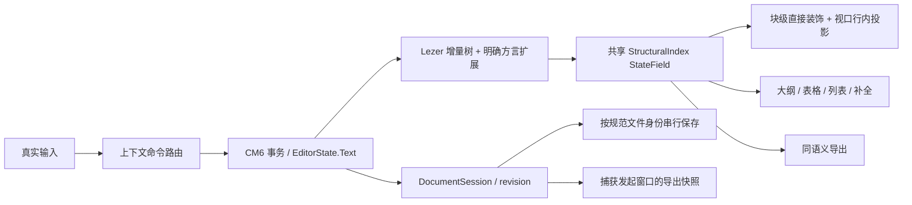

# MarkPilot 3.2.5 质量、架构与日常操作审计

审计日期：2026-10-11。当前结论：截图 Ctrl+V 在本次 3.2.5 测试环境中可用，但发布产物存在两个可导致数据损失的 P0 问题；不能据此把 3.2.5 判定为稳定版。本次修改的是测试工具、依赖锁和文档，产品代码与原发布 bundle 保持原样，失败判据保留为红色。

## 对象、身份和覆盖边界

源码基线为 `f10e74a525440fd27ec88066a997e9400f7c89ab`，来自 [公开仓库](https://github.com/ltmroberthk915/markpilot)。测试的是 [v3.2.5 的 Windows 便携版](https://github.com/ltmroberthk915/markpilot/releases/tag/v3.2.5)，不是旧工作目录中的 2.x 产品。

| 身份 | 实测值 |
| --- | --- |
| 发布文件 | `markpilot-3.2.5-portable.exe`，84,249,389 字节 |
| 发布文件 SHA256 | `df37e3e44bee42637da1dabddd6aeeab9d422aff61f5458505fc1dd19af77d2b`，与 GitHub 发布资产 digest 相同 |
| 发布版实际运行时 | Electron 33.4.11 / Chromium 130.0.6723.191 / Node 20.18.3 |
| 测试机 | Windows，Intel Core Ultra 5 125H，约 23 GiB RAM |
| 发布版引擎 bundle SHA256 | `506a019995027754e35a4ccc53c2400097a65021f812b4401a6c092407d1547c` |

通过应用的只读文件通道校验了发布包内 `main.js`、`preload.js`、`renderer/host.js` 和 `renderer/cm6/app.js`，四份完整 SHA256 均与源码基线的对应文件相同，原始读数在各套件 `metadata.artifactFiles`。这把以下失败联系到了公开源码，而不是只按版本号猜测。

每次 GUI 测试使用独立 profile、独占 app-slot、合成 Markdown/图片；禁止读取或迁移真实用户 profile。Windows 剪贴板只在辅助进程内存备份，测试后恢复；所有有效运行的残留进程列表为空。使用真实 CDP 键鼠输入；事务只用于准备夹具和选区。原生菜单回调、Electron 输入挂点和跳过文件对话框均明确标记，不能当作点选过真实 OS 对话框。截图的红条是 caret 坐标取证标记。

未测试远程主机的实际安装、3.2.4、Windows 安装包安装/升级链路、macOS/Linux GUI、VS Code/Trae 的 2.x 分支、原生输入法合成、全部 Markdown/图表类型、恶意文档利用或长期运行内存泄漏。没有 Typora 的同机比较。这是一轮有明确范围的审计，不是“全部功能均已验收”。

旧 `marcopilot-md-editor` 技能的大量 Vditor/双仓操作属于 1.x/2.x，不能套在 v3 的实现上。本次保留隔离、真实输入、看实际像素、产物身份等适用纪律，并按当前仓库 CM6 与 AGENTS 的约束工作。DSH Desktop 的 GLM 负责文本审查，DeepSeek Flash 负责实际 PNG 的视觉复核；主控复现、核对读数并剔除误报。助手会话、凭据及原始任务日志不公开。

## 实测结果与可复跑入口

安装和运行方法见 [tools/quality/README.md](../tools/quality/README.md)，证据入口见 [quality-3.2.5](verification/quality-3.2.5/README.md)。

| 检查 | 结果 | 解释 |
| --- | --- | --- |
| 历史 CJS 预检 | 124 份，0 语法/选定提前引用/旧绝对依赖路径问题 | 不等于执行过 124 个产品场景 |
| 工具自测 | 8/8 通过 | 含真实回退 TDZ 修复的突变测试、SHA 拒绝、锁归属与证据路径校验 |
| 发布版通用验收 | 19 项：18 通过，1 失败 | 下划线空包裹再次取消仍留 `>` |
| 发布版关键场景 | 26 项：9 通过，17 失败 | 失败按下文问题族归并，不把 17 当成 17 个独立 bug |
| 发布版性能/输入完整性 | 5 档全部通过完整性与无崩溃判据 | 延迟见后表；通过不表示速度足够好 |
| 锁定 NPM 依赖重建 | 构建成功，bundle SHA 不同 | 无法证明与发布版构建可重复或行为等价 |
| 新 bundle 的源码应用验收 | 当时的 17 项：16 通过，1 失败 | 使用 Electron 44.2.0；未跑后来补充的非法 Mermaid 与 Shift 鼠标/双击两项 |

发布版通用验收包括普通键盘、纯鼠标、组合键、Shift 加鼠标、拖选五种通道，真实双击使用 `clickCount:2`，另有固定种子 325 的输入模型、格式选择与 Ctrl+Z/Ctrl+Y、公式、Mermaid 更新及非法源码失败提示、任务框偏移、保存、双窗口和 renderer 异常检查。不同套件有重叠，不相加宣称覆盖率。

### 截图 Ctrl+V：本环境 3.2.5 通过

辅助进程调用 Windows `Clipboard.SetImage` 设置真实 `Bitmap`，随后用 Ctrl+V；没有伪造 DOM paste 事件。合成位图为 400×160 PNG。已验证默认 assets、显式 inline、真正未命名的文档回退 inline、先按纯文本粘贴再普通粘贴，以及 frontmatter 中带明确提示的拒绝。

已保存文档还验证了 PNG 字节、落盘 Markdown、重新打开、加载后的 `naturalWidth/naturalHeight` 与可见图片。[重开后的实际截图](verification/quality-3.2.5/critical/clipboard-assets-reopened.png)显示位图本身，而不只是源码占位。剪贴板恢复成功。这回答的是“3.2.5 在上述条件下能否粘贴”，不能证明 3.2.4 的故障已经修复，也不能覆盖远程安装的用户配置或每一种 Windows 剪贴板格式。

## 已确认的缺陷与优先级

下表是修复问题族；同一族包含多个失败断言。P0 应先于视觉和性能重构处理。

| 问题族 | 级别 | 已复现行为 | 源码线索与修复方向 |
| --- | --- | --- | --- |
| Q01 窗口会话串状态 | P0；附带 P1 表现 | A 有未保存草稿，本来原生关窗会阻止；B 保存后，同一个 A 原生关窗直接关闭，草稿消失。另见 B 的 LF/无 BOM 文件变成 A 的 CRLF/有 BOM，A 的 savedText 变为 B，B 另存为改了 A 的路径状态 | [main.js](../MarkPilot-CM6/main.js#L285) 的 `writeDoc(..., S = state)`；`file:save` 未传 sender 会话；`pickSaveAs` 使用全局 state。按 sender 绑定文档会话，成功确认只能清除对应会话与对应 revision 的脏状态 |
| Q02 UTF-16 中文乱码写回 | P0 | 有 `FF FE` BOM 的纯中文 UTF-16LE 文档通过嗅探，被 UTF-8 解码为替换字符；输入后自动保存，原编码字节被破坏 | [readDoc](../MarkPilot-CM6/main.js#L231) 最后统一 `toString('utf8')`。识别 BOM 并保留编码，或在编辑之前明确拒绝且原字节不变 |
| Q03 PDF 取错窗口内容 | P1 | B 打开后，从 A 发起 PDF 导出，成功生成的 `primary.pdf` 是 B 的正文 | [export:pdf](../MarkPilot-CM6/main.js#L1636) 与全局 `win/send`。导出请求捕获发起窗口、正文 revision 和文档目录 |
| Q04 下划线取消残留 | P1 | 空文档 Ctrl+U → `<u></u>`，再次 Ctrl+U → `>`；发布版与新 bundle 均失败 | [toolbar.js](../dsh-markpilot/src-cm6/toolbar.js#L120) 用 opening 长度处理 closing，3/4 长度不对称。显式保存起止 delimiter 长度 |
| Q05 Enter/Tab 上下文竞争 | P1 | 代码围栏里的 `- install foo` 回车新增 `- `；列表行首回车变成两份 marker；列表内公式候选可见且 frac 已选中，Enter/Tab 却续列表或缩进 | [lists.js](../dsh-markpilot/src-cm6/lists.js#L152) 与 [completion.js](../dsh-markpilot/src-cm6/completion.js#L161) 的 highest keymap 优先级。建立统一上下文判定与命令顺序 |
| Q06 引用内围栏识别分歧 | P1 | 引用围栏里的表格文本被渲成可见表格；引用代码行 Tab 使编辑器失焦 | 投影、表格和按键分别扫描围栏；共享容器感知的结构上下文 |
| Q07 编辑与导出语义分歧 | P1 | 有序列表导出成 UL；`~~~` 在编辑器归为代码而导出没有 PRE、内容被作行内 Markdown；编辑器接受的宽横线表格分隔行导出成数据行 | 编辑和导出使用不同结构判据；共享结构语义，并明确宽横线扩展是否保留 |
| Q08 无空格 # 的标题行为 | P2 兼容/操作契约 | `#话题` 在编辑器变成 H1 | 与 CommonMark 的 ATX 标题规则不同。明确方言决定并统一标题投影、工具栏、大纲与导出 |

Q01 有独立阳性对照：新启动的 A 输入未保存草稿，用聚焦后的原生“关闭窗口”菜单回调 `BrowserWindow.close()`，窗口仍在；另一新启动中加入 B 并实际保存 B，再对 A 用相同动作，A 关闭。没有用可能绕过 beforeunload 的 CDP page.close 来下结论。A 的 UI 仍显示脏标记，因此不是“没输入成功”。此族的其它场景记录了两份磁盘内容；特定 B 保存用例中 A 的物理文件仍是 A，不能泛化成“B 已覆盖 A 的文件”。

Q02 的判据允许两种安全行为：正确解码并保留 UTF-16，或在编辑前带解释地拒绝且字节完全不变。不能为修此问题把所有包含 NUL 的用户文本直接归为二进制；编码判断与既有文本契约需单独测试。

Q03 不只检查中间 HTML。[实际 PDF](verification/quality-3.2.5/pdf/primary.pdf)、[渲染页](verification/quality-3.2.5/pdf/primary-pdf.png)和两种文本提取结果共同确认 B 标记、无 A 标记。PDF SHA256 为 `c5a434343af52bcb1971bdea9de6f727cdf5531d1a7b07e9b3012624a4861b69`。页面视觉只显示一份 B；文本提取存在重复/交错，应列作文本层质量候选，不夸大为视觉重复。`pdf-text-check.py` 保留原始文本且必须读出正向标记，单凭“禁用标记没找到”不能判绿。

Q05 的公式候选有正向对照：普通段落同样的 frac 候选用 Enter/Tab 均成功。代码 Enter 的故障是源码多出 marker，不能说整个代码块变成了列表。

本轮剔除了两类误报：Windows 正常 redo 使用 Ctrl+Y，实测成功；输入文字后再按格式键的行为属于尚未明确的操作契约，不能未经判断记成五个独立格式 bug。Q08 的 CommonMark 判断来自 [规范](https://spec.commonmark.org/0.31.2/#atx-headings)：非空标题的开头 marker 后需空白，同时必须保留 `#` 这种合法空标题。

## 非 bug 的日常操作问题

1. **连续输入中的格式结束缺少明确语义。** 按 Ctrl+B、输入文字、再按 Ctrl+B，得到新空包裹；其它格式类似。空选区开启、再次取消、选区去格式、输入中结束样式应有清楚且一致的规则。以上实测状态放在 `critical/result.json` 的 observations，未算入失败项；应先形成用户合同再实现。
2. **内联图片源码占满编辑区域。** 光标落在图片行时，约 13KB 的 base64 源码铺满屏幕。建议在不修改 Markdown 真源的前提下，提供可折叠源码和明确“展开编辑”动作，并验证复制、选区、撤销和导航。
3. **未命名文档的图片归属需要可发现的操作。** 当前无目录时回退 inline 是安全且测试通过的；用户之后保存文件，应能明确选择保留 inline 或提取到 assets。此处是设计建议，尚未测试保存后的提取流程。
4. **Mermaid 错误提示过于面向实现。** 非法源码能安全失败且原文保留，但整个解析器 token 列表直接占据图表区域。建议先显示“图表语法错误，第 N 行”与定位/展开详情。该项是从实际像素观察的 UX 问题，不是渲染崩溃。
5. **方言的自动纠正需要边界。** 宽横线表格、无空格 # 等便利应有一致的编辑/导出语义与可解释设置，避免普通文本在不同入口得到不同结构。

## 构建与测试基础设施问题

历史共享探针及七个族库在文件开头自动创建输出目录，却把 `path` 的 `require` 放在使用之后，干净进程直接抛 TDZ ReferenceError。已修复八处顺序问题，并将硬编码开发机 Playwright 路径改为本地依赖解析。真实突变测试在隔离临时文件中把 `path` 放回末尾，模块必须重新失败；正常版本成功。这项修复只改变测试脚手架。

本次补充可移植安装锁、历史预检、独占启动与清理、拒绝空套件/错 SHA/非空输出目录、合成 Windows 位图、通用/关键/性能套件、源码构建比较、PDF 只读文本检查以及小型证据发布。大体积安装包、profile、临时 bundle、用户剪贴板内容和模型凭据不入 Git。

原公开 pnpm frozen 安装因 optional peer `@deepseek-ai/dsh` 与 lock/importer 配置不一致而失败。本次提供 `dsh-markpilot/package-lock.json`，用 `npm ci --ignore-scripts --legacy-peer-deps` 固定已测试依赖；构建脚本显式打包且不覆盖仓库 bundle。仍须选定产品正式包管理器、修复其冻结安装并统一 CI。现有 MarkPilot-CM6 的 after-pack、sync-engine、dist-fresh、verify-app、verify-exe 脚本确实存在，不应误报为缺失。

固定 NPM 依赖构建的 app.js 是 1,292,936 字节，SHA256 `ac61b3ad79774f4272e7383801cd37dba68c98891c8a951ffa4eef660dc00c8f`；发布/仓库 bundle 为 1,292,120 字节，SHA256 `506a019995027754e35a4ccc53c2400097a65021f812b4401a6c092407d1547c`。随后两套依赖都重新用 `npm ci` 安装，引擎再次构建得到同一个新 SHA，工具自测再次 8/8 通过。安装后的 language/view/lezer-markdown 等版本与 pnpm lock 内版本有漂移。以上证明依赖与构建身份不一致，不证明差异全部由版本漂移造成，也不能推断 bundle 行为等价。

GitHub 凭据只有 repo/read:org/gist，没有 workflow scope。本次将 [Windows/Linux CI 模板](../tools/quality/ci/quality-tools.yml)公开为普通工具文件，未启用 Actions，未声称云端绿灯。GitHub 对新增工作流的 scope 要求见 [官方说明](https://docs.github.com/en/apps/oauth-apps/building-oauth-apps/scopes-for-oauth-apps)。有权限时移至 `.github/workflows/quality-tools.yml`；它只做工具预检/自测，桌面验收仍需有真实桌面会话的机器。

## 性能基线

输入延迟口径为 CDP insertText 到下一 renderer animation frame 的墙钟时间，包含工具往返与帧调度，不等于纯 CPU 执行时间。每档预热 5 次、30 个有效输入；逐次验证焦点、长度和尾部，最终全文与全部 35 次输入相符。逐样本不做全文序列化。原始时间保留在 [performance/result.json](verification/quality-3.2.5/performance/result.json)。

| 文档 | UTF-16 字符数 | P50 | P95 | 最大 |
| --- | ---: | ---: | ---: | ---: |
| 普通文本 1,000 行 | 33,890 | 17ms | 19ms | 19ms |
| 普通文本 10,000 行 | 348,890 | 45ms | 78ms | 80ms |
| 普通文本 100,000 行 | 3,588,890 | 488ms | 1,030ms | 1,080ms |
| 公式文本 1,000 行 | 23,780 | 17ms | 21ms | 27ms |
| 公式文本 10,000 行 | 257,780 | 55ms | 90ms | 93ms |

所有输入落地，未记录 renderer 崩溃。10 万行的逐键延迟已明显影响编辑。源码里多条全文 `toString`/split/围栏扫描和缓存重建是值得 profiling 的候选；尚无逐函数耗时证据，不能认定全部延迟由某一函数造成。新 bundle 用不同 Electron 与依赖版本，不作为受控升级性能比较。

## 建议架构：CM6 文本真源、共享增量结构、显式文档会话

采用 CM6 并不自动获得最低延迟；最值得保持的优势是不可变 EditorState、事务、增量语法树与视口投影。以下是审计提出的设计，尚未实现、也未经过与同行的公平比较，不宣称“行业最优已经达成”。依据是 [CM6 系统指南](https://codemirror.net/docs/guide/)与[扩展 API](https://codemirror.net/docs/ref/)。



### 1. 文档会话与保存事务先分清

将全局偏好、最近文件和窗口目录，与 `DocumentSession{windowId, docId, canonicalPath, encoding, bom, eol, diskVersion, revision, savedRevision, dirty}` 分离。IPC 必须校验 sender 并取到对应会话，找不到就明确失败；不能静默退回主窗口 state。导出请求捕获不可变正文/结构 revision 与文档目录；窗口打开顺序不能影响接收方。

`SaveCoordinator` 的串行键必须是**规范文件身份**，不是 `(窗口, 文件)`；两个窗口写同一文件仍共享一个队列。规范化要考虑 Windows 大小写、符号链接与文件身份，已有文件可辅以 stat 信息。临时文件按操作 ID/revision 唯一命名，写入和 rename 之后确认磁盘版本；外部变化或另一个窗口更新需要明确冲突合同。成功回执只能确认被写入的 revision，后续输入仍是 dirty。异步另存为/切文档期间也绑定原请求 docId，不从当前可变全局状态重新取来源。

### 2. 一个结构索引，多种投影

优先复用 Lezer Markdown 的增量树，在统一方言层注册数学、frontmatter、引用/列表容器和已确认的兼容扩展。不要立即另写一套全文正则解析器，也不要为迁移删掉当前合法扩展。输出版本化 `StructuralIndex`，供围栏、标题、大纲、列表、表格、补全和导出共同查询。

布局相关块级替换通过 StateField 提供直接装饰；不能把影响垂直布局的块替换寄托于计算完成后的 viewport 插件。行内样式与非布局效果按 visibleRanges 构造，并保留跨视口节点边界。selection-only 变化只更新光标关联块，不重新扫描全文。事务 changedRanges 扩展到必要语法上下文，全文索引可作为慢速 oracle，而非每键常态。

widget 的 eq 比较所有影响显示和定位的字段；共享渲染结果缓存与按文档定位缓存分离。异步 Mermaid/公式结果带 docId/revision/theme，过期即丢弃。缓存按真实占用和生命周期限额，view.destroy 解绑监听、定时器和 DOM 引用。表格 overlay 的 IME/选区与分栏视图独立选区、滚动、历史必须保持已有用户合同。

### 3. 命令优先级是产品合同

统一路由顺序建议：输入法合成保护 → 已打开的有效补全 → 活跃 overlay → 代码上下文 → 表格 → 列表/引用 → 普通 CM6。每条返回明确 handled/continue，与结构索引使用同一个上下文。不能让多个 `Prec.highest` 按注册先后偶然竞争。围栏内 literal list 和引用围栏需保留；格式 span 同时记录两种 delimiter 长度与选区方向。

### 4. 运行时维护与信任边界

发布版仍是 Electron 33.4.11。按 [Electron 支持政策](https://www.electronjs.org/docs/latest/tutorial/electron-timelines)，仅维护最近三个稳定大版本；应安排受支持运行时的固定版本升级和产物回归。当前 `sandbox:false`、较宽的 preload/IPC 文件能力与导航守卫应按 [Electron 安全建议](https://www.electronjs.org/docs/latest/tutorial/security)审查：sender/协议校验、明确能力边界、导航与新窗口策略、最小 preload、合适的 sandbox。以上是维护风险和静态候选，不是本次已证实的任意文件利用或特定 CVE。

### 实施次序和门槛

1. **先修 Q01/Q02/Q03。** 每个修复保留失败夹具，补独立阳性/阴性对照；回退修复时必须转红。多窗口同文件、外部改名/修改、异步 Save As 和未保存关闭一起验收。
2. **修格式与上下文路由。** Q04/Q05 的小而明确修复先上，保持选区/Unicode/撤销；随后迁移结构索引，逐模块用新旧 oracle 比对，再移除旧 scanner。
3. **统一编辑/导出方言。** Q06/Q07/Q08 写出合同和跨层夹具；不要为消除分歧静默禁用原有合法功能。合法空标题 `#`、引用围栏、`~~~`、宽横线策略必须成对测试。
4. **做 profiling 后优化热点。** 使用同机、同 Electron、同依赖、同字体/profile 的配对基线，分别测 typing/selection/scroll/render/save/export、长会话内存与回收。可先设工程目标：本机 1 万行输入 P95 <50ms、10 万行 <100ms；这是拟定目标，尚未达到。若模块迁移破坏合同，切回旧模块并保留反例，不以补丁数量作为唯一质量指标。

## 替代“不断往 DEBUG-DB 添例子”的测试策略

DEBUG-DB 继续保存问题原因与最小反例，但用**风险 × 状态转换 × 输入通道 × 层间不变量**管理覆盖。最优策略须随成本和风险调整，以下是当前项目优先方案：

| 层级 | 核心判据 | 执行时机 |
| --- | --- | --- |
| 工具可信性 | 非空、入口可加载、错误 SHA 拒绝、相反输入必须失败、真实突变转红、锁和证据归属 | 每次工具变动；CI 可跑 |
| 结构/命令纯逻辑 | 共享树上下文、增量结果 = 全量 oracle；容器/转义/Unicode/边界组合 | 每次引擎提交；CI 可跑 |
| 编辑模型 | Text/selection/undo 与操作模型一致；固定种子、多种子、失败自动收缩到最小序列 | 修改相关命令或 StateField 时 |
| 壳层数据合同 | 会话 dirty/revision/BOM/EOL/路径隔离；同文件并发、外部变更、切文件、崩溃恢复 | 每次文件/IPC/保存改动 |
| 真实输入与像素 | 五输入通道，焦点/有效性/坐标/正文/选区/可见投影；真正 OS IME 与位图格式矩阵 | 每次相关交互改动；发布前 |
| 产物验收 | 下载资产 digest、运行实际版本、包内文件 SHA、冻结构建一致性、安装升级、离线资源 | 每次发布 |
| 性能与长期稳定 | 配对 P50/P95/长任务/内存，保证输入全部落地；连续多文档/多窗口循环 | 热点改动与发布前 |

优先增加的矩阵：1/2/3 窗口 × 同文件/不同文件 × 已保存/未命名 × UTF-8/BOM/UTF-16/不同 EOL × 激活窗口/后台窗口 × 保存/另存为/导出/关窗/切文件。再增加围栏 ` ``` / ~~~ ` × 引用/列表嵌套 × completion/表格/Tab/Enter × 视口边界。不要全矩阵笛卡尔爆炸：P0 组合全测，其余用 pairwise 与历史反例加权。

每个确认问题需“正常对照、故障最小序列、修后同判据、真实回退突变、最终包身份”闭环；失败生成独立目录、种子、操作 trace、正文/选区/焦点/文件字节和限额截图。对失败做收缩，最后把最小反例和业务不变量放进长期回归，而不是只保存大批 probe 文件。

下一轮尚需复现的静态候选：同文件双窗口固定临时文件冲突、异步保存与切文档的 revision 竞态、引用转义偏移、分栏事务与历史、监听/渲染缓存回收、恶意导航/IPC 权限边界。它们不在本轮“已确认 bug”列表。实际输入法、安装升级和远程部署身份也必须补测后才能作上线稳定性承诺。
