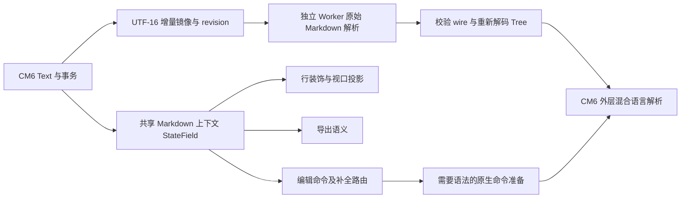

# 3.2.7：编辑上下文、后台语法解析与实际交付

2026-10-12。本轮承接 [3.2.5 审计](LOG-3.2.5-AUDIT.md) 和 [3.2.6 数据安全候选](LOG-3.2.6-CANDIDATE.md)，修复 Q04–Q08 所属的前端问题并处理已测长文输入阻塞。源码、工具、小型证据和安装候选保存在本地；没有推送、合并或发布，也没有升级远程主机。完整文件身份及结果见 [quality-3.2.7](verification/quality-3.2.7/README.md)。

## 用户可见的改变

- 引用、嵌套引用、反引号及波浪线代码围栏使用同一上下文判定。代码中的列表、表格、任务框和 `$` 保持字面文本；回车、选区替换、多光标和 Tab/Shift+Tab 保留代码及引用前缀。
- 列表行首回车不再复制 marker；列表内可见数学补全候选由 Enter/Tab 接受。Ctrl+Space 的数学补全先于原生语法准备，Python 代码中的补全仍进入原生路径。
- 下划线取消完整移除 `<u>` 与 `</u>`，正反选区及空文档都保留正确位置；`#hashtag` 不冒充标题，合法空标题仍有效。
- HTML 导出的有序列表及起始编号、引用围栏、额外字面 `>`、波浪线围栏、表格 delimiter 和宽横线策略与编辑器对齐。
- 代码行号由 CM6 行装饰拥有。移除遍历 DOM 写行号的插件和旧数学位置缓存，减少重复状态及陈旧位置来源。
- Windows 系统剪贴板位图 Ctrl+V 的 assets、inline、未保存文档、保存后重开及前置普通粘贴路径均通过；拒绝向 frontmatter 写入图片的行为有明确判据。

## 架构及取舍

编辑真值只有 CM6 文档。共享围栏索引处理引号层级、关闭字符和长度、关闭行尾信息、EOF、首个正文位置及跨行变化；普通变化映射位置，结构变化重新扫描。保留原有多选区事务，移除不受事务管理的 DOM 行号写入。

超过 128 KiB 的文档启用 Worker，使用 75ms 合并窗口；镜像按 UTF-16 位置及 `baseRevision/revision` 同步。Worker 当前仍执行完整原始 Markdown 解析，**增量同步不等于增量解析**。返回值检查 schema、NodeSet manifest、TreeBuffer 范围和 per-node 属性；每次准备创建独立 Tree，避免外层 MixedParse 挂载节点后污染下一次解析。

使用公开的 `Parser.wrap`、`ParseContext.getSkippingParser` 及混合语言 API，未修改依赖内部代码。pending 的占位树保持 `syntaxTreeAvailable=false`。普通字符输入不强迫同步原生解析；回车、代码缩进、成对字符、按词删除、注释、折叠及语法敏感粘贴在需要时准备当前原生树，然后执行原有命令。

Worker 缺失、15 秒超时或协议不匹配时，该 view 停用 Worker 并降级原生解析，错误保持可观测。旧 Worker 的消息、错误和超时回调均检查实例身份；销毁清除定时器和等待者。`status=failed` 并不意味着语法永远不可用，原生命令准备仍可生成有效树。

构建入口为 `node build-from-source.cjs`，同时生成应用 bundle 和独立 Worker。锁定依赖回建出的两份文件与交付文件 SHA 完全相同。

## 测试策略与结果

策略以实际产物、状态终态及可区分的负向控制为主。真实输入使用 CDP 键盘、鼠标、组合键、键鼠配合及按下→多次移动→抬起的拖拽；每次读数检查编辑器焦点。fixture 可设置初态，但不以合成 DOM 键盘或 paste 事件代替操作。截图包含全图和光标附近真正 2 倍像素密度的局部图；红线是根据浏览器光标矩形绘制的标记，不能当成捕获到原生 caret。

独立 DeepSeek Flash 实际打开截图并检查五通道脚本；GLM 与另一位审查助手只做文本方案及反例审查。辅助报告中的历史版本、帧名和键位判断经主控核对后才用于本记录。

| 范围 | 最终实际产物结果 |
| --- | --- |
| 单元及工具判据 | 56/56 |
| 历史探针预检 | 124 份语法及选定 import 检查通过；没有执行这 124 个 GUI 场景 |
| 编辑及导出定向 | 75/75 |
| 关键回归 | 26/26；剪贴板恢复成功 |
| 通用五通道验收 | 19/19 |
| Worker 与原生命令集成 | 28/28 |
| 窗口及编码数据安全 | 23/23 |
| 七档普通输入性能 | 两轮候选均通过 P95 ≤ 50ms 门槛 |
| 连续结构键延迟记录 | 1/1 完成真实性与完整性判据；没有套用普通输入的 50ms 门槛 |
| 三种 Worker 故障 | 各 4/4，恢复后 asar 及七个文件 SHA 相同 |
| 最终便携包 | 关键 26/26、通用 19/19、Worker 28/28 |
| 隔离安装版 | 关键 26/26、通用 19/19、Worker 28/28；卸载恢复两份原有注册信息 |
| 含空格的隔离安装目录 | 实际安装与卸载通过；内层 exe/asar 一致，前后两份原有注册信息一致 |
| 本机正常升级后的程序 | 3.2.7 升级失败，原程序已恢复；后续正常升级见 3.2.8 记录 |

这些套件存在重叠，不能把条数相加当作独立功能数或覆盖率。异常清单及残留进程清单为空；原生输入法候选窗口未在这些判据内。

### 回归用例是否真能抓住问题

每种回退只作用于隔离源码/产物，开关重复执行保持幂等。恢复后逐文件核对源 SHA、重新构建并核对 bundle/asar SHA，使用同一套件复跑正向。

| 实际源码回退 | 回退后失败 / 同族用例 | 恢复后 |
| --- | --- | --- |
| 共享上下文回到旧扫描 | 26/29 | 29/29 |
| 去掉引用代码 Enter binding | 6/29 | 29/29 |
| 恢复旧 DOM 行号插件 | 2/29 | 29/29 |
| 补全 keymap 回到低优先级 | 6/12 | 12/12 |
| 下划线恢复对称 delimiter 假设 | 4/5 | 5/5 |
| 导出恢复旧方言路径 | 11/11 | 11/11 |

另有真正缺少 Worker 文件、存在但不回复、存在但 schema 错误三种产物故障；并非三种都删除 Worker。真实保存字节、引用代码回车、撤销、代码缩进及成对字符均通过降级验证。实际可读/压缩后的回调代码还经退休实例模型和移除身份检查的负向控制验证；该模型不替代浏览器真实任务队列测试。

## 同机 A/B/A/B 性能证据

A 为同运行时中的同步原生解析基线，B 为最终 3.2.7；按 A1→B1→A2→B2 串行交替，不并发占用应用。每档 5 次预热、30 次有效样本。度量从发送真实输入到下一帧，包含 CDP 往返；没有在每个延迟样本中读取完整文档。首键、预热最大值、帧间隔及最终语法可用性单独记录。

| 场景 | A1 P50/P95 ms | B1 P50/P95 ms | A2 P50/P95 ms | B2 P50/P95 ms |
| --- | --- | --- | --- | --- |
| 正文 10 万行、3,588,890 字符 | 512 / 926 | 17 / 18 | 453 / 908 | 17 / 18 |
| 10 万行退格 | 493 / 1317 | 17 / 19 | 401 / 1394 | 17 / 18 |
| 10 万行代码内普通输入 | 20 / 78 | 17 / 19 | 396 / 843 | 16 / 20 |
| 含公式 1 万行 | 66 / 105 | 17 / 19 | 48 / 85 | 17 / 18 |

原生代码输入两轮波动较大，保留两轮全部读数，不用其中较慢的一轮夸大收益。最终正文 10 万行首键两轮均为 16ms。此结论限本机、合成夹具及指定按键；没有相同硬件/文档下的 Typora 对照，不能声称行业最优。

**结构键仍有待优化。** 555,008 字符文档连续 20 次回车、间隔插入字符，首键 140ms，后续 P50=129ms、P95=162ms，20 次命令准备均触发同步原生路径。这不是只慢第一次，不能用普通字母的 18ms 替代。下一轮优先减少结构命令等待的解析范围，并验证 Worker 内部增量 fragments 的一致性及成本。

## 安装及边界

三个 EXE 的内层程序、完整 asar 和七个核心文件 SHA 均一致；PE fileVersion=3.2.7.0、productVersion=3.2.7。构建运行时为 Electron 33.4.11 / Chromium 130 / Node 20.18.3，打包器 electron-builder 25.1.8；当前候选未签名。

正常升级前已完整备份本机 CM6 3.2.4 的程序、卸载注册项及两份用户配置，并逐文件核对备份。v2 2.3.3 的程序、注册项和配置纳入保护清单。实际程序验收使用独立 profile、禁止从真实旧配置迁移，仅打开合成文档，不打开用户 Markdown 原件。私有备份和大包不进入公开证据。

本机升级暴露了工具调用错误：对含空格的 `MarkPilot CM6` 目录传裸 `/D` 值，25.1.8 模板里的 StdUtils 在首空格截断，再覆盖 NSIS 初始目录，导致卸载旧 CM6 后写入同名 v2 目录。原有备份完整覆盖 CM6，但 v2 仅记录了文件 SHA，未备份二进制，这是执行准备的缺口。当前公开隔离安装工具已按 [StdUtils 参数规则](https://muldersoft.com/docs/stdutils_readme.html)给值加字面引号，并在含空格的私有路径完成真实安装/卸载；生产包无需重建。已恢复 CM6 3.2.4 的 75 个原文件及注册路径；v2 从官方 2.3.3 历史包逐 SHA 恢复全部 76 个原文件，两份安装的注册路径与快捷方式均核对，之后补齐 v2 完整程序备份。3.2.7 的正常升级结果保留失败，后续正确升级见 3.2.8 记录。

用户在处理期间报告 Win+Shift+S 无法截图。系统截图工具驻留 10 个进程；确认无未保存截图后重启截图工具，用户确认快捷键恢复。没有修改系统快捷键注册，未建立该故障与 CDP/剪贴板测试之间的因果关系。用户关闭新打开的应用后保存了新的配置基线，settings/recents 与安装前相同；缓存及 Local/Session Storage 日志在用户打开应用期间发生变化，不以旧缓存覆盖关闭后的状态。

仍未覆盖：Windows 原生输入法候选窗口与系统截图工具的 UI 操作、远程主机实际配置、渲染进程崩溃后的未保存草稿恢复、跨进程最终检查到 rename 的竞争窗口。CDP composition 只证明受信输入的 Unicode/引号及最终文本完整，未观测到 compositionend，不能冒充完整 OS IME 验收。

Electron 支持版本升级、IPC/preload 权限边界的独立安全复核，以及之前记录的 Mermaid 错误提示和未命名文档图片提取 UX 建议，留在后续范围；本轮没有把静态候选或尚未复现风险宣称为已修复漏洞。
