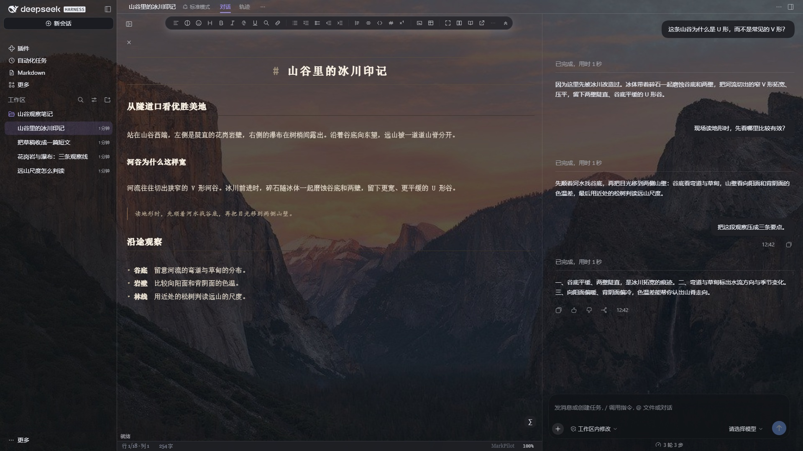

# MarkPilot for DSH 2.1.11

左栏选对话，中间写 Markdown，右栏与 AI 讨论。开启「编辑区透明」，壁纸会原样穿过正文区域。书页和研报各自保留标题样式、排版和明暗配色。



在插件设置中打开「编辑区透明」，随后可以独立调整书页或研报的明暗。文件列表和右侧文件面板都可收起，把更多空间留给正文。关闭透明后，编辑器恢复对应版式的纸色。

## 安装

```sh
dsh plugin --profile desktop add dsh-markdown-editor-typora@2.1.11
```

[下载 GitHub 插件安装包](https://github.com/ltmroberthk915/markpilot/releases/download/dsh-markdown-editor-typora-v2.1.11/dsh-markdown-editor-typora-2.1.11.tgz)
