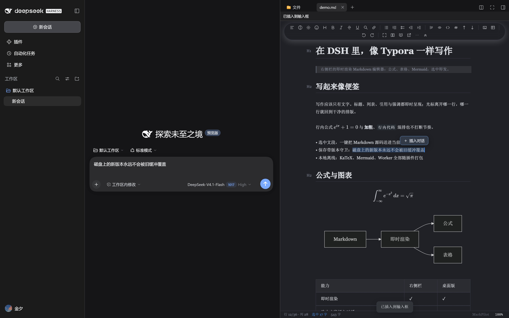
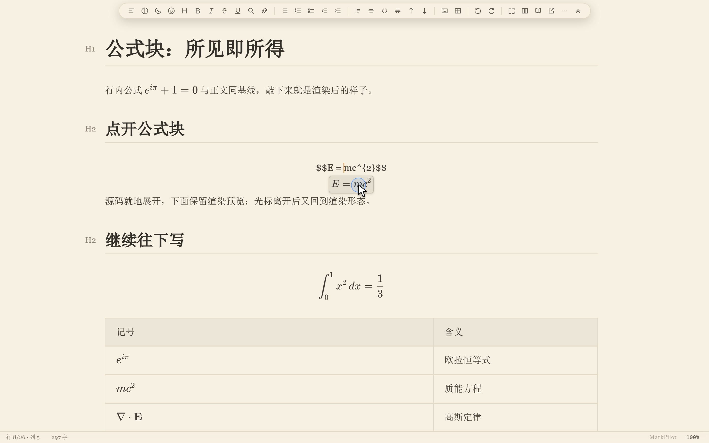
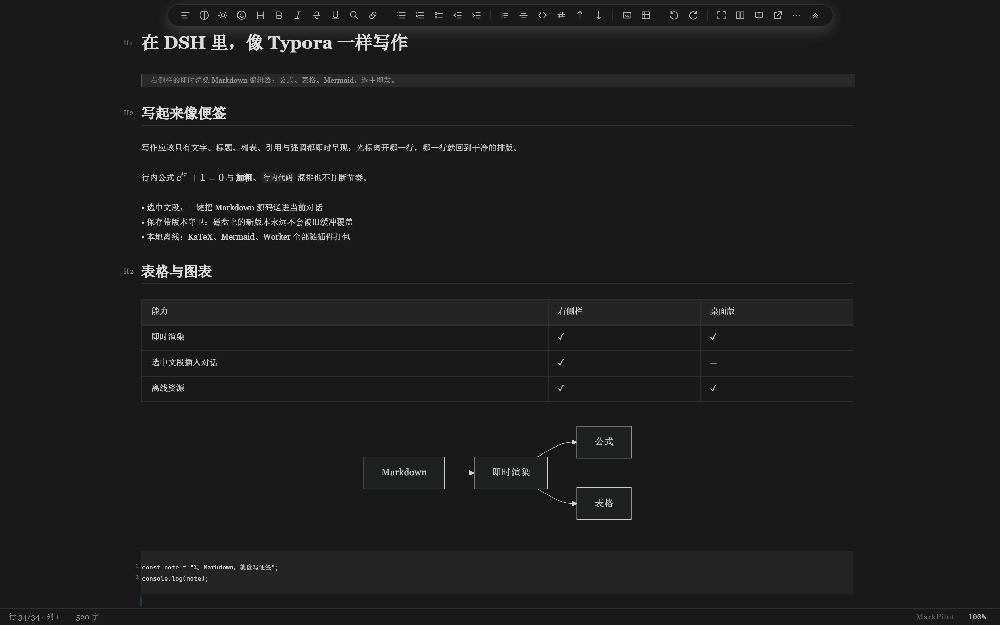
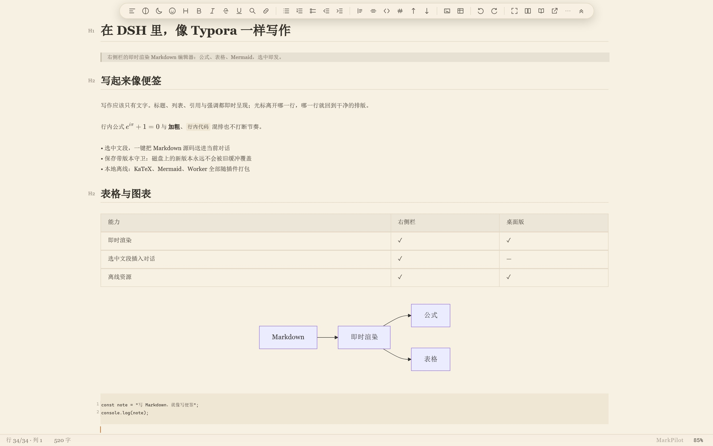
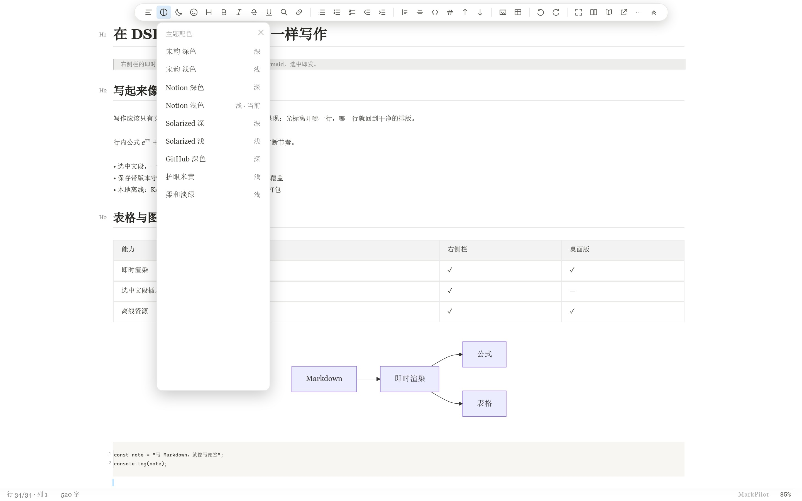
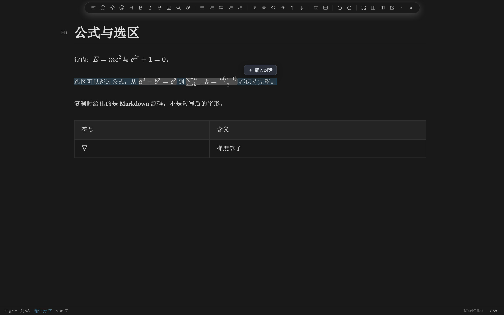
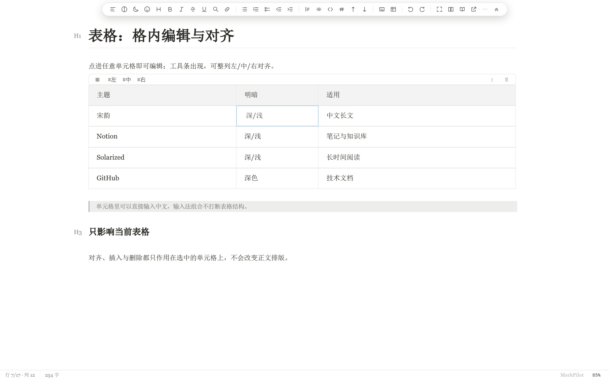

> **更名（1.4.0 起）：** 本插件包名改为 **`dsh-markdown-editor-typora`**（原 `dsh-markdown-typora` 停在 1.3.x）。当前候选：**1.9.0-rc.6**（B4.3 冲突解决 + B3.3b 草稿镜像）；安装：`dsh plugin --profile desktop add <绝对路径>/dsh-markdown-editor-typora-1.9.0-rc.6.tgz`。历史 1.4.0 安装方式仅作参考。

# dsh-markdown-typora

[](https://dshopen.org/zh/plugins/dsh-markdown-editor-typora/)

## MarkPilot for DSH 1.1 · IDE 式 Markdown × AI 工作台

**一边写文档，一边聊 AI，让思路直接变成项目里的 Markdown。** 文件树、编辑器与 AI 对话同屏，整理方案、推敲公式、编写项目文档，都能边写边讨论。



- **选中即聊，精准交给 AI。** 选中文段，一键把 Markdown 源码和文件路径插入当前对话输入框；支持 Ctrl/Cmd+Shift+Enter，也可用 `@mp` 引用当前文档。检查后再发送，上下文由你掌控。
- **像 IDE 一样安排工作空间。** 文件、正文、对话并排，拖动分栏分配空间；收起工具栏专注写作，关闭编辑器恢复原生布局。
- **项目切换，思路不断。** 每个工作目录记住最近打开的笔记；同目录切会话保留文档，跨目录可跟随项目，也可固定当前文档。
- **灵感来了，先写再存。** 直接打开空白稿，首次保存落在所属工作目录；最近文档、文件列表、空白起笔任你选，无历史时另设打开方式。
- **技术写作，也能赏心悦目。** Typora 式即时渲染、可编辑公式与表格、离线 Mermaid、十套主题与透明外观。
- **保存有反馈，写作少打断。** 自动保存、版本冲突提示与草稿恢复；未保存持续显示，已保存三秒后消失。

**开始使用：** 从本仓库构建的 `dsh-markdown-editor-typora-1.9.0-rc.6.tgz` 安装（`dsh plugin --profile desktop add <绝对路径>/dsh-markdown-editor-typora-1.9.0-rc.6.tgz`）。重启 DSH，点击左侧 **Markdown**；打开策略位于 **设置 → Markdown 编辑器 → 打开与切换**。


**1.1.1：** 点开会话只恢复该目录上次打开的文档，不再自动弹出文件列表；文件列表与空白稿在点击左侧 **Markdown** 时打开。安装：`dsh plugin --profile desktop add dsh-markdown-typora@1.1.1`


**1.1.2：** × 关闭记忆按你关掉的那份文档所属目录记录，关闭成功才生效。安装：`dsh plugin --profile desktop add dsh-markdown-typora@1.1.2`

**1.2.0：** 对话里的文件链接、切会话恢复的 Markdown 默认按文档工作台打开（左列表 + 左上角收起/关闭按钮）；设置里可改回全宽浮层。安装：`dsh plugin --profile desktop add dsh-markdown-typora@1.2.0`

**1.2.1：** DSH 重启后恢复的 .md 标签也会被接管进文档工作台，不再停在宿主预览里。安装：`dsh plugin --profile desktop add dsh-markdown-typora@1.2.1`

**1.2.2：** 链接打开的 md 进中间后，右栏的重复标签会自动关闭，右栏不再为此弹出。安装：`dsh plugin --profile desktop add dsh-markdown-typora@1.2.2`

**1.3.1：** 消息里的 `file://` Markdown 链接（此前点了没反应）与绝对路径 `.md` 芯片现在都在捕获阶段被接管，解析成本地路径后直接进中间工作台，不再弹出右栏的改动对比；1.3.0 的认证 fail-closed 宿主修复一并包含。安装：`dsh plugin --profile desktop add dsh-markdown-typora@1.3.1`

**1.3.2：** 修外部修改不刷新（1–2 秒内自动采纳；有草稿时显示可操作的冲突横幅）；修主题不保持（保留所选主题，宿主明暗切换只切同族）；修左右侧栏手柄位置不保持（切会话回来按上次拖动恢复）；透明模式下重新应用设置会恢复透明。安装：`dsh plugin --profile desktop add dsh-markdown-typora@1.3.2`

**1.4.0（更名）：** 包名改为 `dsh-markdown-editor-typora`；含 1.3.2 的三项修复 + live 刷新路径加固。安装：`dsh plugin --profile desktop add dsh-markdown-editor-typora@1.4.0`


[下载 1.1.0](https://github.com/ltmroberthk915/markpilot/releases/tag/dsh-markdown-typora-v1.1.0) · [npm](https://www.npmjs.com/package/dsh-markdown-typora/v/1.1.0)

## MarkPilot for DSH 1.1 · An IDE-style Markdown workspace beside your AI

**Write, discuss and keep the result in your project.** Bring files, Markdown editing and DSH chat together for project docs, research notes and technical writing.

- **Give AI exactly the context you choose.** Insert selected Markdown source and its file path into the chat composer with one click or Ctrl/Cmd+Shift+Enter. Reference the open document with `@mp`; review before sending.
- **Arrange your workspace like an IDE.** Keep files, editor and chat side by side. Resize columns, tuck away the toolbar and restore the native layout when you close the editor.
- **Pick up where each project left off.** Resume the last-opened note per working directory. Keep your document across same-directory conversations; follow a different project or keep the current note open.
- **Start with an idea, save it where it belongs.** Open a blank note and save directly into its original directory, or start from recent notes or the Files panel. Choose a separate fallback for projects without history.
- **Full Markdown editing, beautifully presented.** Typora-style live rendering, editable math and tables, offline Mermaid, ten themes and adjustable transparency.
- **Stay informed without losing focus.** Autosave, version-conflict notices and draft recovery. Unsaved status stays visible; saved status clears after three seconds.

**Install:** `dsh plugin --profile desktop add dsh-markdown-typora@1.1.0`. Restart DSH and click **Markdown**. Opening preferences: **Settings → Markdown 编辑器 → 打开与切换**.


**1.1.1:** conversation switching restores only the note from that working directory; the file list opens when you click **Markdown**. Install: `dsh plugin --profile desktop add dsh-markdown-typora@1.1.1`


**1.1.2:** the × close memory follows the document you actually closed, and only a real close counts. Install: `dsh plugin --profile desktop add dsh-markdown-typora@1.1.2`

**1.2.0:** a Markdown file opened from a conversation link or restored by a working directory opens in the document workspace by default (file list and the floating collapse/close buttons); a setting switches back to the full-width view. Install: `dsh plugin --profile desktop add dsh-markdown-typora@1.2.0`

**1.2.1:** Markdown tabs restored at startup are adopted into the document workspace instead of staying in the right-side preview. Install: `dsh plugin --profile desktop add dsh-markdown-typora@1.2.1`

**1.2.2:** a Markdown link opens in the middle workspace and the duplicate right-sidebar tab closes itself. Install: `dsh plugin --profile desktop add dsh-markdown-typora@1.2.2`

**1.3.1:** `file://` Markdown links in a message (previously inert) and absolute `.md` path chips are taken over in the capture phase and opened in the middle workspace instead of bringing up the sidebar change preview. This build includes the 1.3.0 fail-closed host authentication fix. Install: `dsh plugin --profile desktop add dsh-markdown-typora@1.3.1`

**1.3.2:** external edits reach the editor (1–2 s; unsaved drafts show an actionable banner); the chosen editor theme survives host light/dark switches and conversation switches; dragged sidebar/right-bar widths are restored after a conversation switch; re-applying the transparency setting restores transparency. Install: `dsh plugin --profile desktop add dsh-markdown-typora@1.3.2`

**1.4.0 (renamed):** the package is now `dsh-markdown-editor-typora`. It carries the 1.3.2 fixes plus hardening of the live refresh path. Install: `dsh plugin --profile desktop add dsh-markdown-editor-typora@1.4.0`


[Get 1.1.0](https://github.com/ltmroberthk915/markpilot/releases/tag/dsh-markdown-typora-v1.1.0)

*以下保留各产品与历史版本介绍；DSH 插件当前安装方式以本节 1.1.0 为准。* *Historical product and version details remain below; the 1.1.0 instructions above are current.*


**A Markdown editor for the DeepSeek Harness right sidebar, built on MarkPilot CM6 3.6.17.**

Write Markdown in DSH with Typora-style live rendering; select a passage and send its **Markdown source** straight into the current conversation.

## Screenshots

| | |
| --- | --- |
| **Selection → chat, inside DSH**<br> | **A formula block, Typora-style — click a glyph and the source caret lands on it**<br> |
| **Notion dark**<br> | **护眼米黄 (sepia light)**<br> |
| **9 themes, switchable from the toolbar**<br> | **A selection that crosses inline formulas**<br> |
| **Table cells are real cells**<br> | **Images render in the document**<br> |

## Beyond Typora, inside DSH

- **Click a formula to edit its source** — block and inline math expand to the editable `$…$` source in place, and return to the rendered form when the caret leaves.
- **Selections keep formulas whole** — a selection that crosses inline math carries complete formulas; copy and cut hand back the Markdown source, not the rendered glyphs.
- **Table cells, not table text** — an alignment toolbar appears over the table, with row/column operations, escaped pipes, Chinese IME composition and undo/redo kept in sync with the cell source.
- **Ten built-in themes** — 宋韵 (dark, light and the restored V2 deep-blue), Notion (dark/light), Solarized (dark/light), GitHub dark, 护眼米黄 and 柔和淡绿. Follow the host, or pick one from the toolbar.
- **Live Mermaid, KaTeX and the Markdown worker, all offline** — diagrams, math and fonts load from the plugin; there is no CDN in the path.
- **Large documents** — the Markdown syntax tree is built in a web worker, so a 150,000-character document loads and accepts typing without the UI thread parsing it.
- **Selection → chat** — the DSH-specific move: the selection's Markdown source goes into the current conversation from the floating button or `Ctrl/Cmd + Shift + Enter`.
- **Guarded saves** — version-checked writes, a conflict banner instead of an overwrite, and a recovery slot when a tab closes with unsaved edits.

## Features

- **Real editor, not a preview** — CodeMirror 6 with live headings, lists, tables, inline math, code blocks and Mermaid.
- **Selection → chat** — a floating **Insert into chat** button appears beside a selection; `Ctrl/Cmd + Shift + Enter` does the same. The payload starts with the document's absolute path, then a blank line and the Markdown source (not the rendered text), inserted at the composer caret without stealing focus.
- **Guarded saves** — debounced autosave with version checks; `Ctrl/Cmd + S` saves immediately with a visible result, whether the caret is in the editor or elsewhere in the panel. An external edit is never overwritten. A dirty buffer is kept in a recovery slot when the tab closes.
- **Shared notes across windows** — the same file can be edited in the MarkPilot desktop app and the DSH sidebar at once. Unsaved changes are exchanged live, each window keeps its own undo history, and a genuine conflict is reported with the draft preserved.
- **Save files outside the session workspace** — a file opened from the sidebar saves directly to its own folder even when it sits outside the workspace root of the current session; version checks and conflict warnings are unchanged. Files that are read-only or locked at the OS level still report an error.
- **Theme-aware** — follows the host's light/dark theme, including the first frame.
- **Offline assets** — KaTeX fonts, the Markdown worker and Mermaid ship with the plugin; no CDN.
- **Document reference** — type `@mp` in the composer to reference the open document.
- **Local images in the document** — `` and parent-folder references such as `` render in the panel, read through the plugin's own read-only image route; a file that is genuinely missing still shows an explicit placeholder instead of an empty box.
- **Edit right beside an image** — a click in the blank to the right of an image starts editing on the following line (headings, lists and task items keep their markers), instead of opening the image's Markdown source; clicking the image itself still opens its source.

## What's new in the 3.6.17 engine

The editor engine is the same accepted build that ships with MarkPilot 3.6.17. Since the 0.3.4 plugin, the right sidebar gained the engine's multi-window work and the save-path fixes that came with it:

- **Shared editing across windows** — the same note can be open in the desktop app and the DSH sidebar. Unsaved edits are exchanged live, each window undoes only its own typing, and a real conflict is shown with the draft kept instead of overwriting the other window.
- **Save while typing** — a save in flight is re-synced to the latest text; an external writer is detected and reported; the recovery banner's **Keep my changes** now actually writes the shared draft; and a cut → undo → redo followed by Ctrl+S no longer fails as an invalid collaborative edit.
- **Reverse selections** — dragging from a rendered formula across code, images or into the previous paragraph keeps the selection under the pointer, including auto-scroll at the top edge.
- **Table and rich-paste editing** — cell commands, End/Backspace, escaped pipes, Chinese IME composition, and pasted HTML tables keep captions, source links, inline images and alignment.
- **Cross-note cut** — real images and local Markdown links are re-based when a passage moves between lecture and summary notes; included definitions are renamed without breaking existing references.
- **Plugin manager reload** — notes opened after a plugin reload still join the live session, and repeated reloads reuse the background writer instead of leaking workers.
- **Restored V2 theme** — the final V2 release's deep-blue Song palette is back as **宋韵 深蓝** (#2E3440), a tenth built-in theme; the existing 宋韵 深色 stays unchanged.

## Install

### 1.9.0-rc.6 candidate

Install the exact tarball, not a package-name/latest lookup:

- Desktop: **Settings → Plugins → Add plugin**, choose the absolute path to `dsh-markdown-editor-typora-1.9.0-rc.6.tgz`. Desktop profile is managed by the Electron app; `dsh plugin --profile desktop …` is rejected by the CLI.
- Web/host profile: `dsh plugin --profile web add /absolute/path/dsh-markdown-editor-typora-1.9.0-rc.6.tgz`
- Verify SHA256 against `SHA256SUMS.txt` before installing.
- Restart the host afterwards; check **Plugins** and the **Markdown** entry.

Older 1.9.0/rc.1/rc.2 tarballs are pre-GA and must not be installed.

### Manual (development checkout)

The plugin is the `dsh-markdown-typora/` subdirectory of the [MarkPilot repository](https://github.com/ltmroberthk915/markpilot). To load a checkout as a bundle:

```sh
git clone https://github.com/ltmroberthk915/markpilot.git
```

Then add a junction/symlink from the profile's `node_modules` to `markpilot/dsh-markdown-typora`, add `"dsh-markdown-typora"` to the profile `package.json`'s `dsh.profile.bundles`, and restart the host. The plugin must be a bundle, not a raw `cordis.patch.yml` file-URL insert, to appear in the Plugins page.

## Use

1. Open the right sidebar, press `Ctrl+P` (workspace files) and click a `.md` file.
2. Write; the editor autosaves after 1.5 s and refuses to overwrite a newer file on disk.
3. Select a passage → click **Insert into chat** (or `Ctrl/Cmd + Shift + Enter`). The document's absolute path is placed at the top, then a blank line and the selection.
4. To undo the insertion, click back into the composer and press `Ctrl/Cmd + Z`; focus stays in the editor by design.

## How it is built

The editor engine is the already-built MarkPilot CM6 3.6.17 renderer, copied byte-for-byte into `renderer-cm6/cm6/`. The plugin adds only:

- `renderer-cm6/index.html` + `dsh-bridge.js` + `dsh-selection.js` — the DSH skin and selection bridge;
- `lib/index.js` — static routes, version-guarded file API, SSE change stream;
- `lib/client.js` — the right-sidebar tab, iframe lifecycle, save/conflict/recovery, composer insertion.

The engine source is not modified. `core.json` records the version and a SHA-256 for every core file. Maintainers of the MarkPilot monorepo can refresh it with:

```sh
node dsh-markdown-typora/scripts/sync-core.mjs
node dsh-markdown-typora/scripts/sync-core.mjs --check
```

## Known limits

- Desktop-only MarkPilot features that need Electron native APIs (export, image picker) may be unavailable in DSH.
- Image references are resolved against the document's folder, so relative paths (`assets/…`, `../figures/…`) work; an absolute Windows path (``) does not render in DSH, and a reference whose filename contains `#`, `?` or `%` cannot be addressed as a URL.
- A selection over 256 KiB is rejected with a message instead of being silently truncated.
- Insertion does not steal focus; undo it from the composer.
- Requires a DSH host whose `connection` service exposes `requestRejection` (verified on DSH 0.2.1-rc.5). Hosts without it are refused with `503 host-auth-unavailable`; 1.3+ deliberately does not fall back to loopback authentication.

## License

MIT. The MarkPilot engine and its bundled Mermaid/KaTeX assets retain their upstream licenses; see [THIRD-PARTY-NOTICES.md](THIRD-PARTY-NOTICES.md).

## MarkPilot 1.0

Enjoy a wider writing canvas, compact vertical workbench controls, live transparency and theme updates, and stable table editing when moving between your document and AI chat. Closing the editor restores the native workspace layout; an optional setting keeps adjustable split handles available. Windows layout and file-worker optimizations improve responsiveness while preserving existing editor features.

Install this release with `dsh plugin --profile desktop add dsh-markdown-typora@1.0.0`, or use `dsh-markdown-typora-1.0.0.tgz` from the matching GitHub release. The earlier version-specific examples above remain as historical installation examples.


## MarkPilot 1.1 · Workspace memory

Click Markdown to return to the last note opened in the current conversation’s working directory. In **Settings → Markdown 编辑器 → 打开与切换**, choose a recent note, the native Files panel, or a blank document; choose a separate fallback when no recent note exists. Recent notes follow the order you opened them, independent of file modification times.

Switching to another working directory follows this opening choice by default. Select **保持当前文档** to keep your note across directories. Conversations in the same directory always preserve the current document. Unsaved notes stay in local recovery when switching safely.

Blank documents create no file until their first Ctrl/Cmd+S. That save creates a uniquely named `未命名-….md` directly in the original working directory; subsequent edits autosave. Rename the file using your normal file tools after saving. The top save indicator shows only **未保存** while dirty and **已保存** for three seconds after a confirmed save.

Install `dsh-markdown-typora@1.1.0` or the matching GitHub release archive, then restart DSH. Windows and DSH 0.2.2-rc.1 are the validated combination for these workspace features; the bundled editor core remains 3.6.17.


## MarkPilot for DSH 1.1.1 · 打开更安静 / A quieter open

点开会话时，编辑器只恢复该工作目录上次打开的文档；该目录还没有文档时不弹文件列表、也不新建空白稿，跟随模式下会收起上一个目录的文档。文件列表与空白文档在点击左侧 Markdown 时按设置打开。同一目录内切换会话仍保留当前文档与未保存内容。用 × 关掉编辑区后该工作目录会被记住，下次点开会话不再自动弹出文档或文件列表，直到你重新打开这个目录里的文档（点 Markdown 或从文件树打开）；未保存的草稿仍留在本地，点 Markdown 可以接着写。

Switching conversations restores only the note from that working directory. A directory without a note stays quiet: no file list, no blank document, and a document from another directory steps aside. The file list and blank notes open when you click Markdown, following the opening settings. Conversations in the same directory keep the current document and unsaved edits. Closing the editor with × is remembered per working directory: conversations there open without the editor or the file list until you open a document from that directory again (click Markdown, or open it from the file tree). Unsaved drafts stay on disk and are restored when you click Markdown.

Install `dsh-markdown-typora@1.1.1` or the matching GitHub release archive, then restart DSH.


## MarkPilot for DSH 1.1.2 · 关的是哪份，就记哪份 / The project you closed stays quiet

用 × 关掉编辑区时，记忆落在你关掉的那份文档所属的工作目录，而不是此刻会话所在的目录；关闭没真正完成时不留记忆。重新打开该目录里的文档（点 Markdown、最近列表或文件树）即恢复自动打开。

Closing the editor with × remembers the working directory of the document you actually closed, not the conversation in front. A close that cannot complete yet leaves no memory. Opening a document from that directory again restores automatic opening.

Install `dsh-markdown-typora@1.1.2` or the matching GitHub release archive, then restart DSH.


## MarkPilot for DSH 1.2.0 · 被动打开也带那组按钮 / Same controls wherever a document opens

对话里的文件链接、切会话时恢复的 Markdown 默认按文档工作台打开（左列表 + 左上角收起/关闭按钮），与点 Markdown 一致；可在设置里改回全宽浮层。

A Markdown file opened from a conversation link or restored by a working directory opens in the document workspace by default, with the file list and the floating collapse/close buttons. A setting switches back to the full-width view.

Install `dsh-markdown-typora@1.2.0` or the matching GitHub release archive, then restart DSH.


## MarkPilot for DSH 1.2.1 · 重启后恢复的文档也进工作台

DSH 重启后恢复的 .md 标签会被接管进文档工作台，不再停在宿主预览；只含这些预览的右栏会被收起；设置里可改回全宽浮层。× 关闭记忆保持不变。

Markdown tabs restored at startup are adopted into the document workspace instead of staying in the right-side preview; the setting switches back to the full-width view. Closing with × keeps its meaning.

Install `dsh-markdown-typora@1.2.1` or the matching GitHub release archive, then restart DSH.


## MarkPilot for DSH 1.2.2 · 点链接不再弹右栏

对话里的 Markdown 链接开进中间工作台后，右栏的重复标签会自动关闭；右栏只剩它时随之一并收起。

A Markdown link opens in the middle workspace and the duplicate right-sidebar tab closes itself.

Install `dsh-markdown-typora@1.2.2` or the matching GitHub release archive, then restart DSH.

## MarkPilot for DSH 1.3.0 · 认证 fail-closed / Fail-closed authentication

文件 API 的信任栅栏现在只认宿主的 `connection.requestRejection`：宿主缺少这个能力（或 `connection` 服务不存在）时，插件对自身全部路由返回 `503 host-auth-unavailable`，并打一条明确的启动日志。此前的 loopback Host/Origin 兜底放行已删除——它在认证能力缺失时等于跳过鉴权；1.3.0 起不再兼容这类旧宿主，宁可插件不可用，也不放行未认证的文件读写。

The file API's trust fence now trusts only the host's `connection.requestRejection`. A host that lacks the capability — or has no `connection` service — receives `503 host-auth-unavailable` on every plugin route, and a single startup warning explains why. The loopback Host/Origin fallback is gone: when authentication is unavailable it silently skipped the check, so 1.3.0 drops compatibility with such hosts instead of failing open. This is the fail-closed behavior requested in [polang233/dsh-plugin-index#213](https://github.com/polang233/dsh-plugin-index/issues/213).

Install `dsh-markdown-typora@1.3.0` or the matching GitHub release archive, then restart DSH.


## MarkPilot for DSH 1.3.1 · 文档链接一律进工作台

消息里的 `file://` Markdown 链接此前点击没有任何反应；1.3.1 起在捕获阶段解析成本地路径并在中间工作台打开。绝对路径的 `.md` 芯片同样走工作台，不再连带弹出右栏的改动对比。本版同时包含 1.3.0 的认证 fail-closed 宿主修复。

`file://` Markdown links and absolute `.md` path chips now open in the middle workspace instead of being ignored or opening the sidebar change preview. Includes the 1.3.0 fail-closed host authentication fix.

Install `dsh-markdown-typora@1.3.1` or the matching GitHub release archive, then restart DSH.


## MarkPilot for DSH 1.3.2 · 外部修改会刷新了

外部进程（另一个会话、git、编辑器）改写正在打开的 md 后，插件会自动从磁盘采纳新内容：协同编辑房间在收到变更事件后先向磁盘对齐，再把差异下发给编辑区；干净文档 1–2 秒内更新。

有未保存草稿时不再静默：「文件已在磁盘上更新」横幅提供「重载磁盘版本」（用磁盘内容覆盖草稿）与「复制我的内容」（保留草稿）。

External edits now reach the editor: a live room adopts the disk text before pushing deltas, and an unsaved draft surfaces an actionable banner instead of stale content.

Install `dsh-markdown-typora@1.3.2` or the matching GitHub release archive, then restart DSH.


## MarkPilot for DSH 1.4.0 · 更名

包名改为 `dsh-markdown-editor-typora`（原 `dsh-markdown-typora` 停在 1.3.x）。内部路由前缀、tab 类型与恢复槽键随包名一起更新；设置与最近文档存储键（`dsh.markpilot.*`）保持不变，升级后用户设置不丢。

The package is renamed to `dsh-markdown-editor-typora`; internal route prefix, tab type and recovery-slot keys follow the new name, while `dsh.markpilot.*` settings storage is unchanged.

Install `dsh-markdown-editor-typora@1.4.0` or the matching GitHub release archive, then restart DSH.


## MarkPilot for DSH 1.7.0 · AI 改的就是你眼前这一份 / AI edits the document you see

MarkPilot 打开着某篇文档时，AI 的 `markdown` 工具会读取编辑器里的当前内容——包括你还没保存的修改——并直接在这份内容上做替换。改动会立刻出现在编辑区，随后按编辑器既有的自动保存节奏落盘；每次 AI 修改前都会保留一份可恢复的旧稿副本。

如果 AI 读取之后你又改了同一段，AI 会收到“版本已过期”，必须重新读取后再改，不会静默覆盖你刚输入的内容。未打开的文档仍按原方式直接读写文件。

While a document is open in MarkPilot, the AI `markdown` tool reads the editor's current text — including unsaved changes — and edits that text. The change appears in the editor immediately and follows the editor's normal auto-save cadence; a recoverable copy of the pre-edit text is kept. If you change the same region after the AI read, the edit is refused as stale and the AI must read again instead of overwriting your input. Files that are not open keep the normal disk behavior.

Install `dsh-markdown-editor-typora@1.7.0` or the matching GitHub release archive, then restart DSH.
