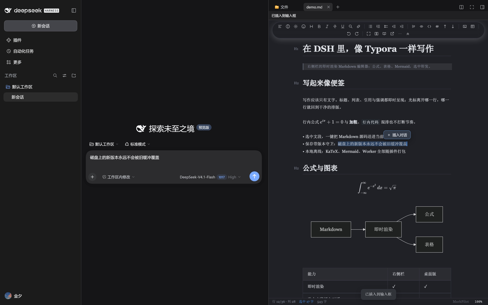
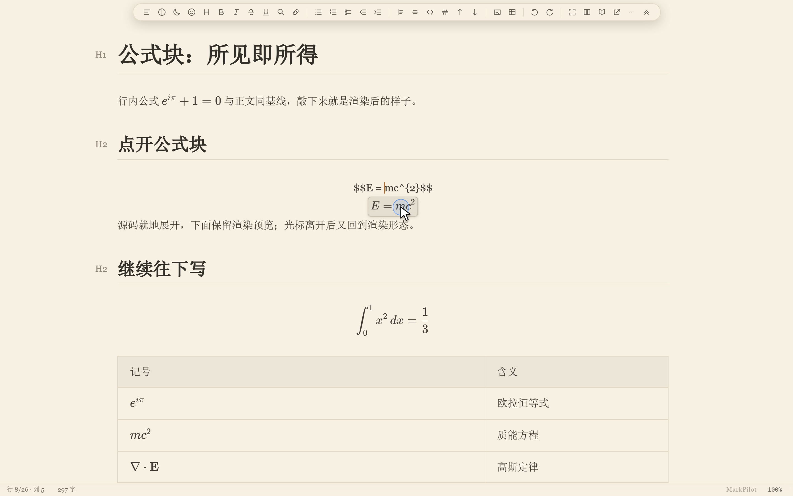
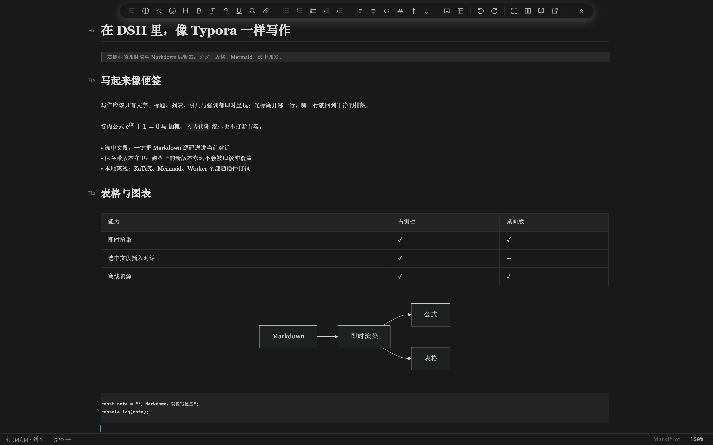
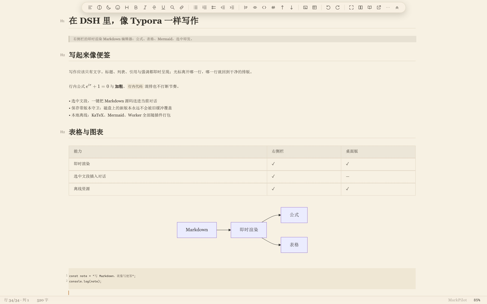
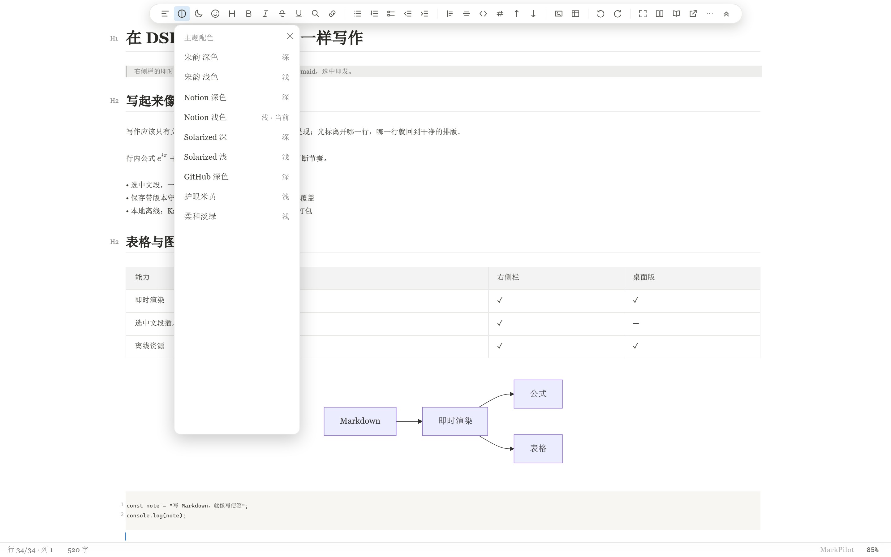
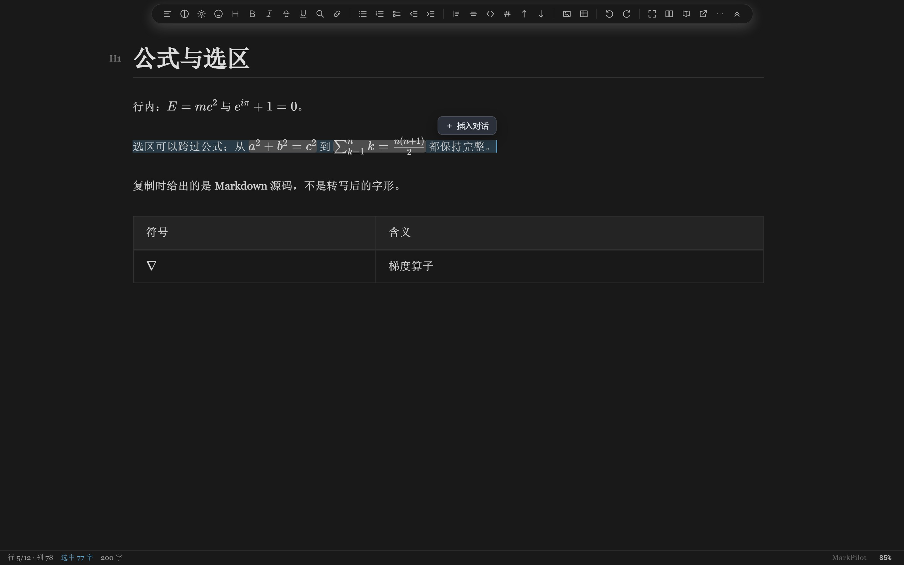
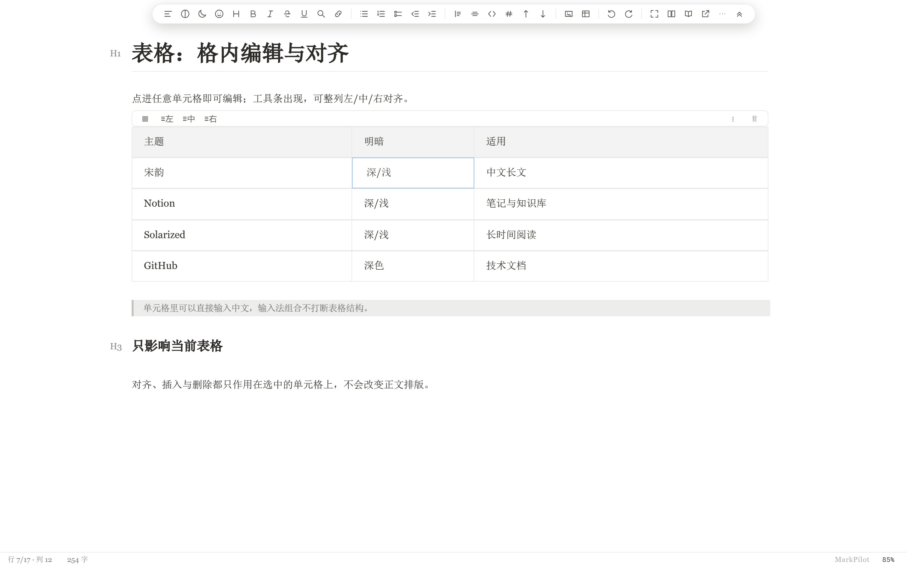
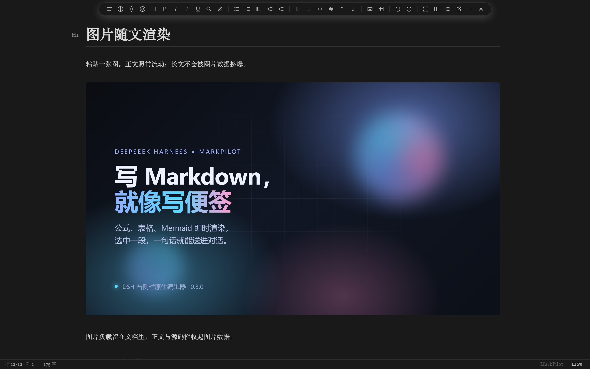

# dsh-markdown-typora

**A Markdown editor for the DeepSeek Harness right sidebar, built on MarkPilot CM6 3.6.16.**

Write Markdown in DSH with Typora-style live rendering; select a passage and send its **Markdown source** straight into the current conversation.

## Screenshots

| | |
| --- | --- |
| **Selection → chat, inside DSH**<br> | **A formula block, Typora-style — click a glyph and the source caret lands on it**<br> |
| **Notion dark**<br> | **护眼米黄 (sepia light)**<br> |
| **9 themes, switchable from the toolbar**<br> | **A selection that crosses inline formulas**<br> |
| **Table cells are real cells**<br> | **Images render in the document**<br> |

## Beyond Typora, inside DSH

- **Click a formula to edit its source** — block and inline math expand to the editable `$…$` source in place, and return to the rendered form when the caret leaves.
- **Selections keep formulas whole** — a selection that crosses inline math carries complete formulas; copy and cut hand back the Markdown source, not the rendered glyphs.
- **Table cells, not table text** — an alignment toolbar appears over the table, with row/column operations, escaped pipes, Chinese IME composition and undo/redo kept in sync with the cell source.
- **Nine built-in themes** — 宋韵 (dark/light), Notion (dark/light), Solarized (dark/light), GitHub dark, 护眼米黄 and 柔和淡绿. Follow the host, or pick one from the toolbar.
- **Live Mermaid, KaTeX and the Markdown worker, all offline** — diagrams, math and fonts load from the plugin; there is no CDN in the path.
- **Large documents** — the Markdown syntax tree is built in a web worker, so a 150,000-character document loads and accepts typing without the UI thread parsing it.
- **Selection → chat** — the DSH-specific move: the selection's Markdown source goes into the current conversation from the floating button or `Ctrl/Cmd + Shift + Enter`.
- **Guarded saves** — version-checked writes, a conflict banner instead of an overwrite, and a recovery slot when a tab closes with unsaved edits.

## Features

- **Real editor, not a preview** — CodeMirror 6 with live headings, lists, tables, inline math, code blocks and Mermaid.
- **Selection → chat** — a floating **Insert into chat** button appears beside a selection; `Ctrl/Cmd + Shift + Enter` does the same. The payload starts with the document's absolute path, then a blank line and the Markdown source (not the rendered text), inserted at the composer caret without stealing focus.
- **Guarded saves** — debounced autosave with version checks; `Ctrl/Cmd + S` saves immediately with a visible result, whether the caret is in the editor or elsewhere in the panel. An external edit is never overwritten. A dirty buffer is kept in a recovery slot when the tab closes.
- **Shared notes across windows** — the same file can be edited in the MarkPilot desktop app and the DSH sidebar at once. Unsaved changes are exchanged live, each window keeps its own undo history, and a genuine conflict is reported with the draft preserved.
- **Save files outside the session workspace** — a file opened from the sidebar saves directly to its own folder even when it sits outside the workspace root of the current session; version checks and conflict warnings are unchanged. Files that are read-only or locked at the OS level still report an error.
- **Theme-aware** — follows the host's light/dark theme, including the first frame.
- **Offline assets** — KaTeX fonts, the Markdown worker and Mermaid ship with the plugin; no CDN.
- **Document reference** — type `@mp` in the composer to reference the open document.
- **Local images in the document** — `` and parent-folder references such as `` render in the panel, read through the plugin's own read-only image route; a file that is genuinely missing still shows an explicit placeholder instead of an empty box.
- **Edit right beside an image** — a click in the blank to the right of an image starts editing on the following line (headings, lists and task items keep their markers), instead of opening the image's Markdown source; clicking the image itself still opens its source.

## What's new in the 3.6.16 engine

The editor engine is the same accepted build that ships with MarkPilot 3.6.16. Since the 0.3.4 plugin, the right sidebar gained the engine's multi-window work and the save-path fixes that came with it:

- **Shared editing across windows** — the same note can be open in the desktop app and the DSH sidebar. Unsaved edits are exchanged live, each window undoes only its own typing, and a real conflict is shown with the draft kept instead of overwriting the other window.
- **Save while typing** — a save in flight is re-synced to the latest text; an external writer is detected and reported; the recovery banner's **Keep my changes** now actually writes the shared draft; and a cut → undo → redo followed by Ctrl+S no longer fails as an invalid collaborative edit.
- **Reverse selections** — dragging from a rendered formula across code, images or into the previous paragraph keeps the selection under the pointer, including auto-scroll at the top edge.
- **Table and rich-paste editing** — cell commands, End/Backspace, escaped pipes, Chinese IME composition, and pasted HTML tables keep captions, source links, inline images and alignment.
- **Cross-note cut** — real images and local Markdown links are re-based when a passage moves between lecture and summary notes; included definitions are renamed without breaking existing references.
- **Plugin manager reload** — notes opened after a plugin reload still join the live session, and repeated reloads reuse the background writer instead of leaking workers.

## Install

### From npm

```sh
dsh plugin --profile web add dsh-markdown-typora
dsh plugin --profile desktop add dsh-markdown-typora
```

Or open **Settings → Plugins → Add plugin** and enter `dsh-markdown-typora`. Restart the host afterwards; the plugin then appears on the **Plugins** page and opens from the right sidebar.

### From a GitHub release

Download `dsh-markdown-typora-0.3.11.tgz` from the [MarkPilot releases](https://github.com/ltmroberthk915/markpilot/releases) and add it to the profile that runs your host:

```sh
dsh plugin --profile web add ./dsh-markdown-typora-0.3.11.tgz
dsh plugin --profile desktop add ./dsh-markdown-typora-0.3.11.tgz
```

When the npm registry lists 0.3.11, installing by package name above gives this build; if the registry copy still lags, use the TGZ above to get exactly 0.3.11.
### Manual (development checkout)

The plugin is the `dsh-markdown-typora/` subdirectory of the [MarkPilot repository](https://github.com/ltmroberthk915/markpilot). To load a checkout as a bundle:

```sh
git clone https://github.com/ltmroberthk915/markpilot.git
```

Then add a junction/symlink from the profile's `node_modules` to `markpilot/dsh-markdown-typora`, add `"dsh-markdown-typora"` to the profile `package.json`'s `dsh.profile.bundles`, and restart the host. The plugin must be a bundle, not a raw `cordis.patch.yml` file-URL insert, to appear in the Plugins page.

## Use

1. Open the right sidebar, press `Ctrl+P` (workspace files) and click a `.md` file.
2. Write; the editor autosaves after 1.5 s and refuses to overwrite a newer file on disk.
3. Select a passage → click **Insert into chat** (or `Ctrl/Cmd + Shift + Enter`). The document's absolute path is placed at the top, then a blank line and the selection.
4. To undo the insertion, click back into the composer and press `Ctrl/Cmd + Z`; focus stays in the editor by design.

## How it is built

The editor engine is the already-built MarkPilot CM6 3.6.16 renderer, copied byte-for-byte into `renderer-cm6/cm6/`. The plugin adds only:

- `renderer-cm6/index.html` + `dsh-bridge.js` + `dsh-selection.js` — the DSH skin and selection bridge;
- `lib/index.js` — static routes, version-guarded file API, SSE change stream;
- `lib/client.js` — the right-sidebar tab, iframe lifecycle, save/conflict/recovery, composer insertion.

The engine source is not modified. `core.json` records the version and a SHA-256 for every core file. Maintainers of the MarkPilot monorepo can refresh it with:

```sh
node dsh-markdown-typora/scripts/sync-core.mjs
node dsh-markdown-typora/scripts/sync-core.mjs --check
```

## Known limits

- Desktop-only MarkPilot features that need Electron native APIs (export, image picker) may be unavailable in DSH.
- Image references are resolved against the document's folder, so relative paths (`assets/…`, `../figures/…`) work; an absolute Windows path (``) does not render in DSH, and a reference whose filename contains `#`, `?` or `%` cannot be addressed as a URL.
- A selection over 256 KiB is rejected with a message instead of being silently truncated.
- Insertion does not steal focus; undo it from the composer.
- Tested against DSH 0.2.1-rc.3; the plugin requires `dsh >= 0.2.0-rc.2`.

## License

MIT. The MarkPilot engine and its bundled Mermaid/KaTeX assets retain their upstream licenses; see [THIRD-PARTY-NOTICES.md](THIRD-PARTY-NOTICES.md).