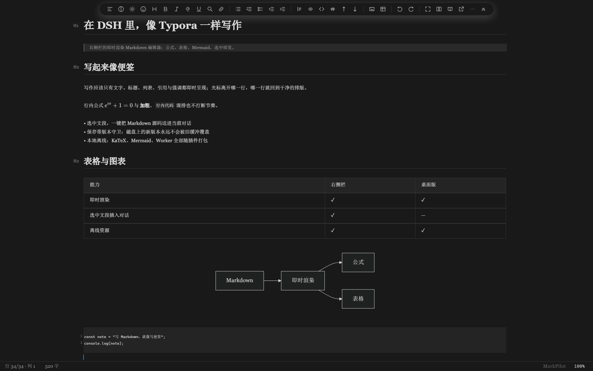
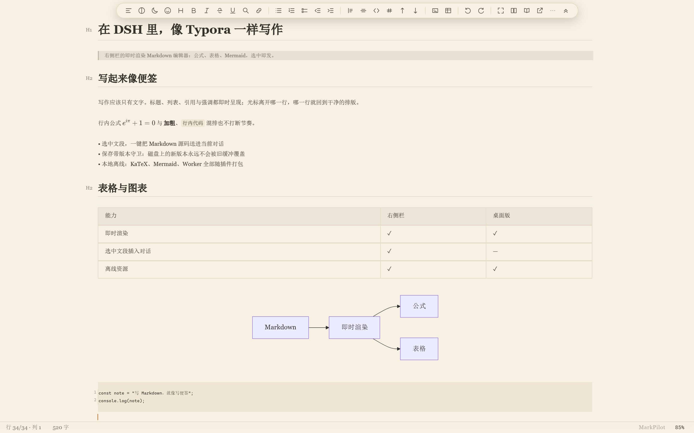
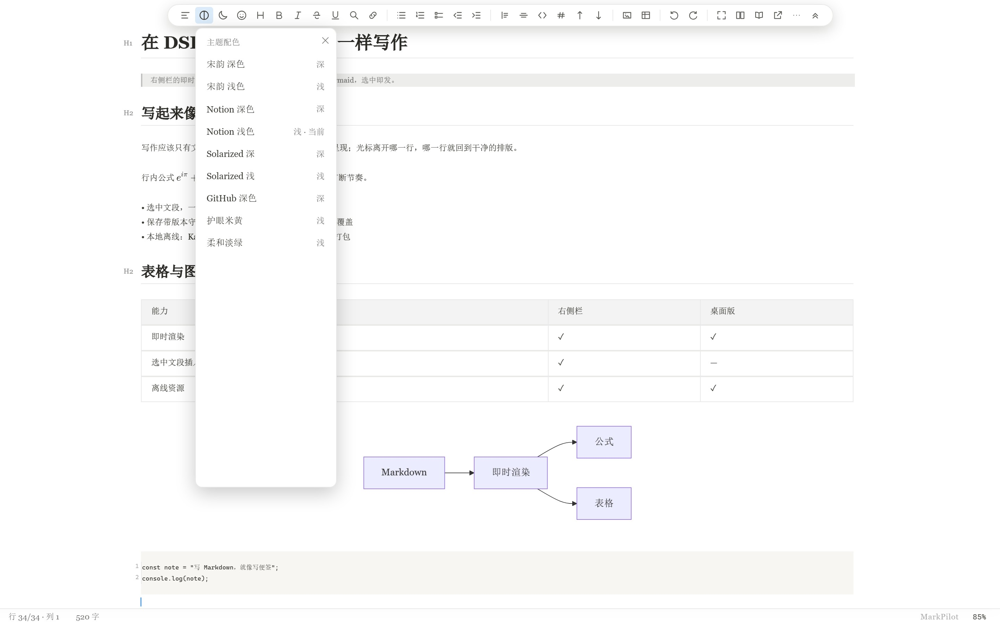
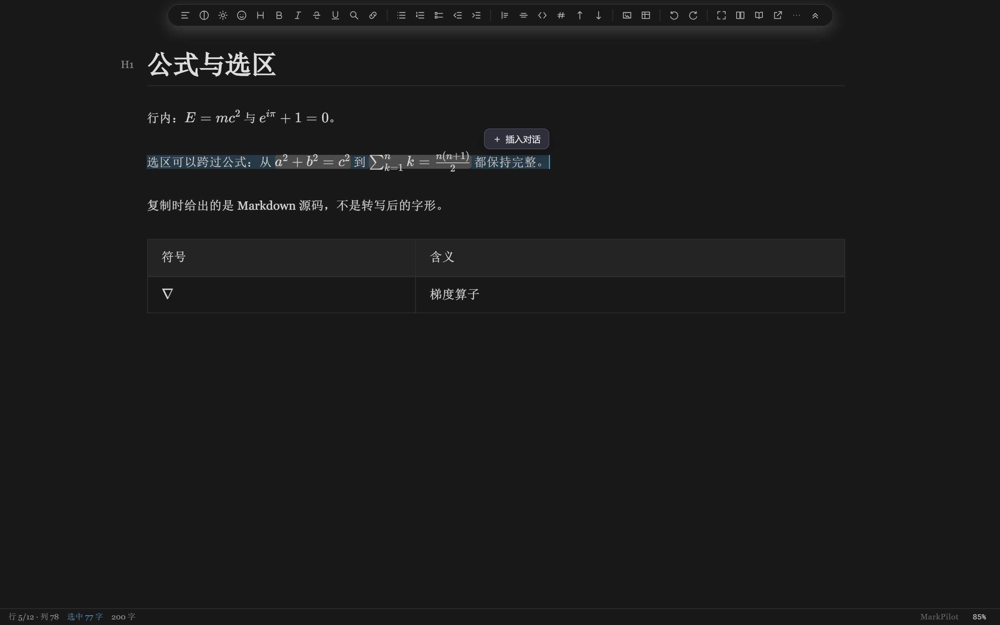
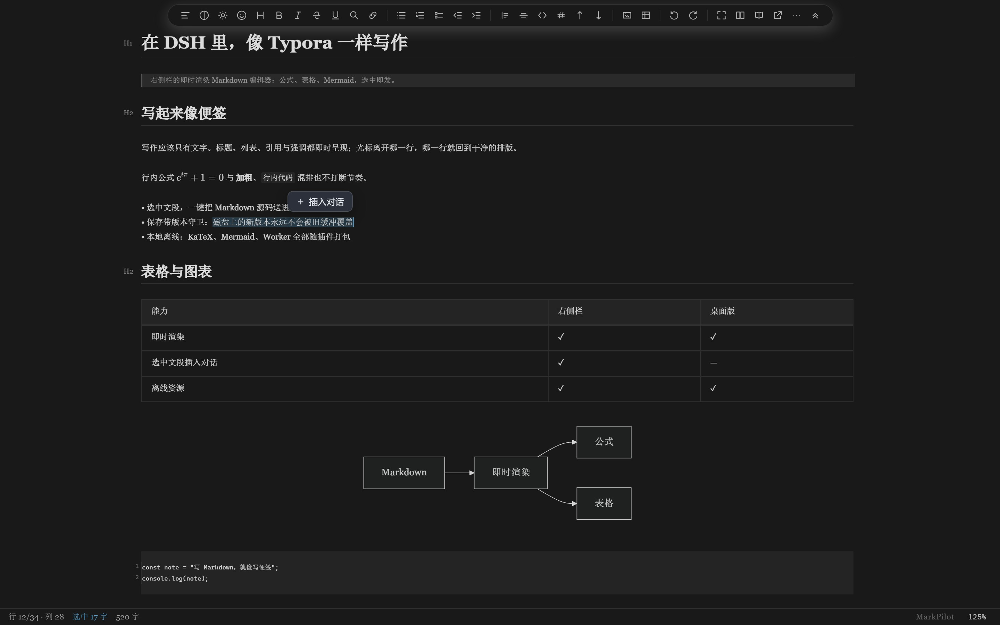
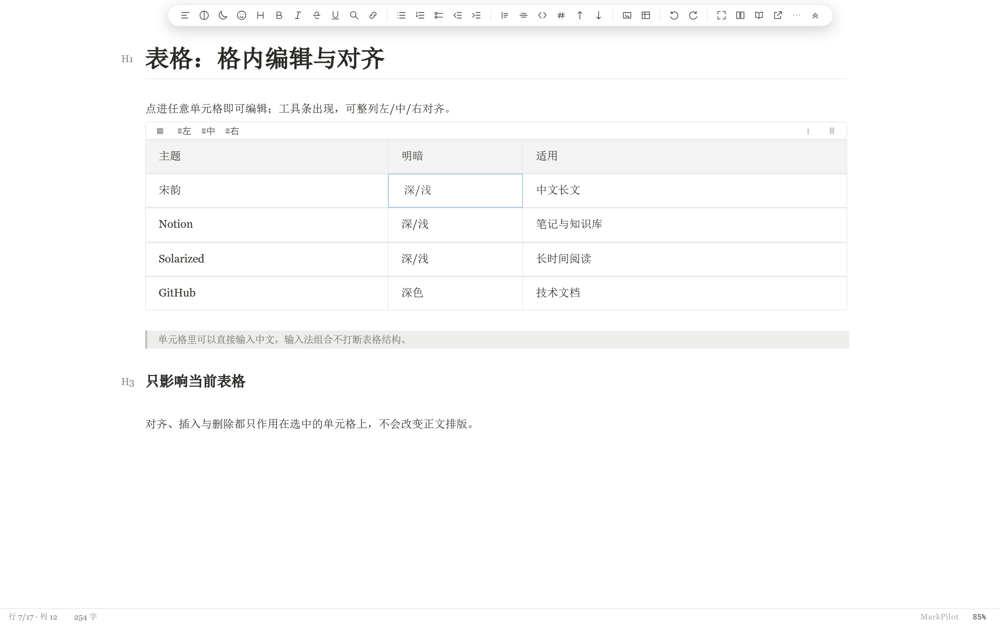
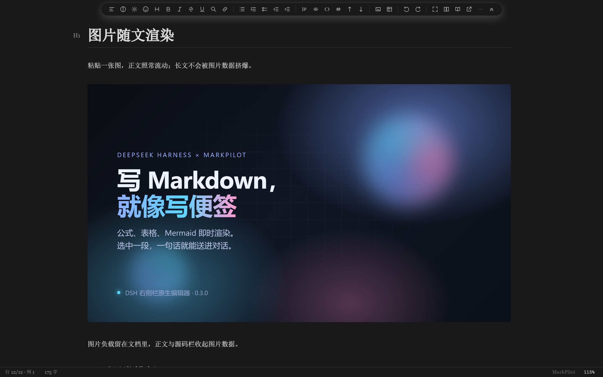
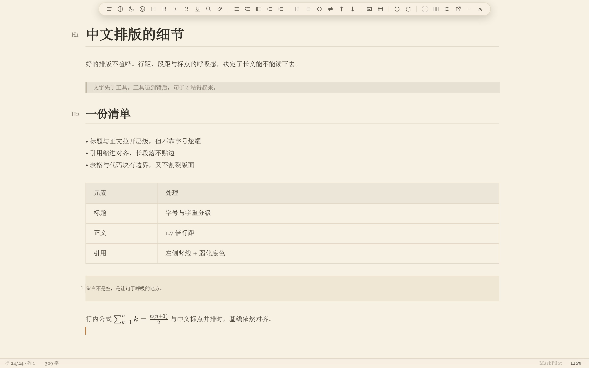

# dsh-markdown

**A Markdown editor for the DeepSeek Harness right sidebar, built on MarkPilot CM6 3.6.6.**

Write Markdown in DSH with Typora-style live rendering; select a passage and send its **Markdown source** straight into the current conversation.

## Screenshots

| | |
| --- | --- |
| **Notion dark**<br> | **护眼米黄 (sepia light)**<br> |
| **9 themes, switchable from the toolbar**<br> | **A selection that crosses inline formulas**<br> |
| **Selection → chat**<br> | **Table cells are real cells**<br> |
| **Images render in the document**<br> | **Chinese typography**<br> |

## Beyond Typora, inside DSH

- **Click a formula to edit its source** — block and inline math expand to the editable `$…$` source in place, and return to the rendered form when the caret leaves.
- **Selections keep formulas whole** — a selection that crosses inline math carries complete formulas; copy and cut hand back the Markdown source, not the rendered glyphs.
- **Table cells, not table text** — an alignment toolbar appears over the table, with row/column operations, escaped pipes, Chinese IME composition and undo/redo kept in sync with the cell source.
- **Nine built-in themes** — 宋韵 (dark/light), Notion (dark/light), Solarized (dark/light), GitHub dark, 护眼米黄 and 柔和淡绿. Follow the host, or pick one from the toolbar.
- **Live Mermaid, KaTeX and the Markdown worker, all offline** — diagrams, math and fonts load from the plugin; there is no CDN in the path.
- **Large documents** — the Markdown syntax tree is built in a web worker, so a 150,000-character document loads and accepts typing without the UI thread parsing it.
- **Selection → chat** — the DSH-specific move: the selection's Markdown source goes into the current conversation from the floating button or `Ctrl/Cmd + Shift + Enter`.
- **Guarded saves** — version-checked writes, a conflict banner instead of an overwrite, and a recovery slot when a tab closes with unsaved edits.

## Features

- **Real editor, not a preview** — CodeMirror 6 with live headings, lists, tables, inline math, code blocks and Mermaid.
- **Selection → chat** — a floating **Insert into chat** button appears beside a selection; `Ctrl/Cmd + Shift + Enter` does the same. The Markdown source (not the rendered text) is inserted at the composer caret, without stealing focus.
- **Guarded saves** — debounced autosave with version checks; an external edit is never overwritten. A dirty buffer is kept in a recovery slot when the tab closes.
- **Theme-aware** — follows the host's light/dark theme, including the first frame.
- **Offline assets** — KaTeX fonts, the Markdown worker and Mermaid ship with the plugin; no CDN.
- **Document reference** — type `@mp` in the composer to reference the open document.

## What's new in the 3.6.6 engine

The editor engine is the same accepted build that ships with MarkPilot 3.6.6:

- **Source view for long documents** — documents that carry embedded images can now show the rendered page and editable source side by side.
- **Embedded-image protection** — body text and the source view keep image payloads collapsed, and an image can be backed up to an `assets` folder next to the document before it is removed.
- **Table editing** — Chinese IME composition, escaped pipes, formatting commands and undo/redo stay in sync with the cell source.
- **Formula selections** — a selection that crosses an inline formula keeps the whole formula, so copying and continued editing stay predictable.

## Install

### From a GitHub release

Download `dsh-markdown-0.3.0.tgz` from the [MarkPilot releases](https://github.com/ltmroberthk915/markpilot/releases) and add it to the profile that runs your host:

```sh
dsh plugin --profile web add ./dsh-markdown-0.3.0.tgz
dsh plugin --profile desktop add ./dsh-markdown-0.3.0.tgz
```

Restart the host afterwards; the plugin then appears on the **Plugins** page and opens from the right sidebar. The plugin market listing follows the public release.

### Manual (development checkout)

The plugin is the `dsh-markdown/` subdirectory of the [MarkPilot repository](https://github.com/ltmroberthk915/markpilot). To load a checkout as a bundle:

```sh
git clone https://github.com/ltmroberthk915/markpilot.git
```

Then add a junction/symlink from the profile's `node_modules` to `markpilot/dsh-markdown`, add `"dsh-markdown"` to the profile `package.json`'s `dsh.profile.bundles`, and restart the host. The plugin must be a bundle, not a raw `cordis.patch.yml` file-URL insert, to appear in the Plugins page.

## Use

1. Open the right sidebar, press `Ctrl+P` (workspace files) and click a `.md` file.
2. Write; the editor autosaves after 1.5 s and refuses to overwrite a newer file on disk.
3. Select a passage → click **Insert into chat** (or `Ctrl/Cmd + Shift + Enter`).
4. To undo the insertion, click back into the composer and press `Ctrl/Cmd + Z`; focus stays in the editor by design.

## How it is built

The editor engine is the already-built MarkPilot CM6 3.6.6 renderer, copied byte-for-byte into `renderer-cm6/cm6/`. The plugin adds only:

- `renderer-cm6/index.html` + `dsh-bridge.js` + `dsh-selection.js` — the DSH skin and selection bridge;
- `lib/index.js` — static routes, version-guarded file API, SSE change stream;
- `lib/client.js` — the right-sidebar tab, iframe lifecycle, save/conflict/recovery, composer insertion.

The engine source is not modified. `core.json` records the version and a SHA-256 for every core file. Maintainers of the MarkPilot monorepo can refresh it with:

```sh
node dsh-markdown/scripts/sync-core.mjs
node dsh-markdown/scripts/sync-core.mjs --check
```

## Known limits

- Desktop-only MarkPilot features that need Electron native APIs (export, image picker) may be unavailable in DSH.
- A selection over 256 KiB is rejected with a message instead of being silently truncated.
- Insertion does not steal focus; undo it from the composer.
- Tested against DSH 0.2.1-rc.3; the plugin requires `dsh >= 0.2.0-rc.2`.

## License

MIT. The MarkPilot engine and its bundled Mermaid/KaTeX assets retain their upstream licenses; see [THIRD-PARTY-NOTICES.md](THIRD-PARTY-NOTICES.md).
